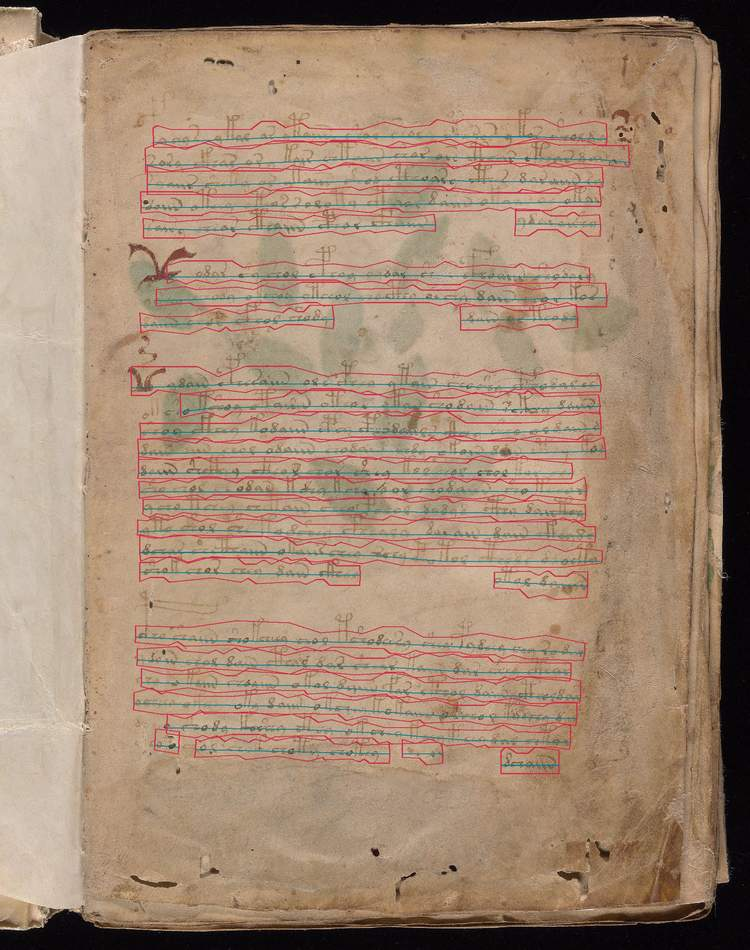
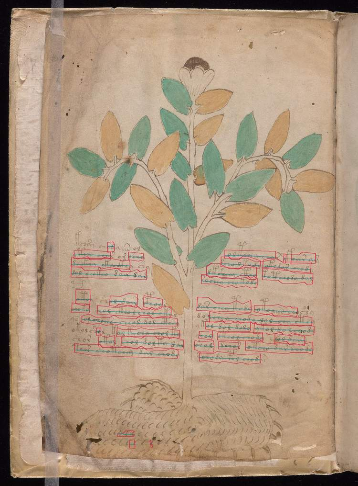

# 48. Kraken 7.1: primer experimento sobre imágenes reales de Voynich

Fecha: 14-10-2026. Rama: `experiment/kraken-voynich`.

**Ejecutado. Resultado científico: `FAIL_COUNT_PROXY`. Reconocimiento supervisado: `BLOCKED_PENDING_REVIEWED_LINE_IMAGE_TRANSCRIPT_ALIGNMENTS`. Entrenamiento y traducción: `NOT_RUN`.**

Kraken funciona y tiene utilidad para preparar transcripciones; el modelo de segmentación general no está listo para emparejar automáticamente recortes con las líneas de Boxer en estas páginas. El primer cuello de botella observado es distinguir y agrupar regiones/fracciones de línea, sin atribuir al dibujo una lectura.

## Qué se ejecutó

[Protocolo previo](47_kraken_pilot_protocol.md), commit `5e293f663d6865acdef7fbb3dcc89e47718e3180`. [Código ejecutado](https://github.com/MedinaParra/Voynich/blob/6c6c2a35efb778bc4eb0dca920e5cc64d752749b/research_gpt6/code/kraken_layout_pilot.py), commit `6c6c2a35efb778bc4eb0dca920e5cc64d752749b`. [GitHub Actions](https://github.com/MedinaParra/Voynich/actions/runs/38605310303), job 115994555067, intento 1: **completed / success**. Los 16 controles de fallo pasaron; esto acredita la ejecución, no el éxito del criterio científico.

Se instalaron Kraken 7.1, Torch 2.9.0+cpu y Python 3.12.15. El modelo de segmentación incluido se verificó contra el blob fijado. Se descargaron las cuatro imágenes directamente desde Yale (HTTP 200), se verificaron las fuentes Boxer y el mapeo literal de imágenes por hash de Git y se ejecutaron ambos métodos a dos resoluciones. No se usaron perfiles semánticos del repositorio del mapeo.

El piloto de inferencia y adquisición duró 107.75 segundos, excluyendo instalación del entorno. Fue sobre CPU y no entrenó ninguna red. La novedad de reconocimiento PP-OCRv6 de Kraken 7.1 queda sin evaluar.

## Resultado descriptivo por página

Las 53 líneas de Boxer son filas de texto de bloque en una transcripción, no 53 cajas geométricas anotadas. Un segmento detectado puede ser una fracción de esa fila. Los conteos no son CER ni precisión espacial.

| Página | Filas Boxer | Neuronal 1800 px | Neuronal 1200 px | Clásico 1800 px |
| --- | ---: | ---: | ---: | ---: |
| f1r | 24 | 30 | 31 | 0 |
| f1v | 9 | 39 | 40 | 0 |
| f2r | 12 | 31 | 31 | 0 |
| f2v | 8 | 20 | 22 | 0 |
| Total | 53 | 120 | 124 | 0 |

El criterio fijado exigía desviación de conteo <= 15%, cambio <= 1 en cada página y cero detecciones en blanco, con las cuatro páginas completas. La desviación neuronal fue 67/53 = **126,42%** y f2v cambió en dos segmentos al bajar resolución: **falla el criterio**. Una desviación puede superar 100%; no significa precisión negativa.

El clásico devuelve cero segmentos en las cuatro páginas y en ambas resoluciones. Sus ocho avisos indican demasiados componentes conectados tras la binarización. Aunque su pérdida de conteo sea menor (100%), una salida vacía no es una mejor transcripción: el conteo aislado favorece soluciones degeneradas. No se presenta ese resultado como ventaja práctica del método clásico.

## Controles y estabilidad

En la página histórica con escritura conocida y 44 cajas de línea anotadas:

| Método | Segmentos | Coincidencias uno-a-uno | Precisión de cajas | Recall de cajas | F1 geométrico |
| --- | ---: | ---: | ---: | ---: | ---: |
| Neuronal | 51 | 41 | 0,8039 | 0,9318 | **0,8632** |
| Clásico | 131 | 34 | 0,2595 | 0,7727 | 0,3886 |

Las coincidencias exigen IoU >= 0,5. Es un control técnico de una sola página del repositorio Kraken; no sabemos si fue vista durante el desarrollo del modelo. No es validación externa de glifos Voynich.

El modelo neuronal encontró cero líneas en blanco. El clásico rechazó la imagen vacía con la excepción documentada, aceptada por el protocolo. La consistencia neuronal entre resoluciones fue alta: F1 de cajas 0,9836; 0,9620; 1,0000; 0,9524. Puede ser estable y a la vez fragmentar o localizar mal: consistencia no es exactitud. La estabilidad aparente del clásico vacío tampoco aporta recuperación de texto.

## Inspección visual

Se inspeccionaron f1r y f1v mediante las vistas generadas por la ejecución. Hay fragmentación de líneas y algunas detecciones dentro de la ilustración inferior de f1v. Además, una fila lógica de Boxer puede reunir fragmentos separados visualmente por una planta; no se debe convertir automáticamente cada segmento en una fila de texto.

Estas vistas son reducciones a 750 px con contornos y baselines de la condición neuronal de 1800 px. No son anotación humana independiente ni imágenes originales a resolución nativa.

La prueba muestra por qué necesitamos fijar la unidad de anotación: región, fragmento conectado y fila de transcripción pueden diferir. No identifica lengua, valor fonético o significado.

## Evidencia y auditoría

- [Resultado completo](results/kraken_pilot/kraken_pilot_result.json), recuperado de los logs y conservado sin reserializar.
- [Resumen](results/kraken_pilot/kraken_pilot_summary.json).
- [Auditoría](results/kraken_pilot/kraken_pilot_ci_audit.json).
- [Plan inmutable](data/kraken_pilot_plan.json).
- [Controles de fallo](code/test_kraken_layout_pilot.py).
- [Workflow](../.github/workflows/kraken-layout-pilot.yml).

El SHA-256 del resultado completo coincide con el emitido por la ejecución; también coinciden hashes de plan, código, modelo y commit. Una implementación JavaScript independiente recalculó **1494 comprobaciones**, incluyendo normalización de geometría, errores de conteo, cardinalidad máxima de correspondencias uno-a-uno y F1: cero discrepancias. Esto reproduce métricas de salidas registradas; no es otra ejecución de Kraken.

El artifact `kraken-pilot-full-evidence` contiene fuentes descargadas y todas las vistas. Tamaño: 18937891 bytes; digest registrado por GitHub: `sha256:99d9fd960fe46318b32c5cbc0c38e4ebe430a49fb5e7ff3c19b0a8b6527adfc3`. Expira el 2026-11-13T17:19:35Z. El ZIP no se extrajo ni se volvió a calcular su digest en esta sesión, porque no hay entorno local disponible. Se conservan en esta rama el JSON completo y dos vistas; las demás imágenes permanecen en el artifact durante su retención.

## Decisión para continuar la ruta Kraken

La siguiente inversión útil es una anotación específica de regiones y fragmentos de texto, conservando su vínculo con la fila y párrafo de Boxer y los signos inciertos. eScriptorium permite corregir regiones/baselines; después se puede entrenar un segmentador y un reconocedor con una notación operativa definida. Las dos caras de cada hoja deben permanecer juntas al reservar datos.

Todavía no hay pares revisados de recorte y transcripción para medir CER sobre Voynich. Igualar 53 filas con 53 recortes mediante selección posterior sería un ajuste al resultado. No se entrena sobre emparejamientos automáticos erróneos ni se promueve el OCR de un idioma conocido a lectura del manuscrito.

**Conclusión autorizada:** Kraken ofrece una base funcional y auditable, pero su segmentador general falla este piloto de preparación automática sobre página completa. El problema de anotación es concreto y se puede abordar; esta prueba no resuelve el manuscrito ni descarta la ruta de reconocimiento supervisado.

Fuentes: [Kraken 7.1 y su actualización de reconocimiento](https://github.com/mittagessen/kraken/releases/tag/7.1), [Boxer](https://github.com/alexanderboxer/voynich-attack/tree/255bd632e45459230eaf2a994e0557ed6c682869), [Yale](https://collections.library.yale.edu/catalog/2002046). La identificación de ilustraciones no se usó como etiqueta de entrenamiento.
