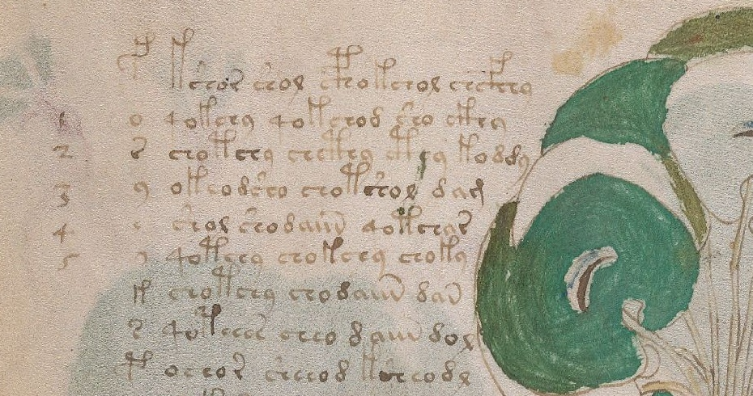

# 55 - Primer inventario de números y contexto

Fecha: 26 de octubre de 2026. Rama: `experiment/kraken-voynich`.

**Estado: DESCRIPTIVE_FIRST_INVENTORY_NO_DECIPHERMENT.** Se documentan 20 casos dirigidos y se tabulan los 12 diagramas zodiacales conservados. No es un censo exhaustivo de toda la foliación ni una prueba confirmatoria. La selección se hizo después de consultar imágenes y antecedentes. La revisión visual es de un asistente, sin segunda lectura paleográfica experta.

El resultado útil es distinguir cifras legibles, marcas de organización del códice, posibles numerales y cantidades contables en dibujos. No se ha validado un valor numérico para ningún signo del texto principal.

## Hallazgos por contexto

| Hoja o grupo | Observación | Interpretación de trabajo | Confianza en la función |
| --- | --- | --- | --- |
| f26r, f42r, f71r, f103r | 26, 42, 71, 103 en el margen superior | Foliación: identificar hojas | Alta |
| f8v | `Pmus`, abreviación ordinal | Primer cuaderno; el trazo final no se interpreta como nueve | Alta |
| f103r | 20 en el margen inferior izquierdo | Cuaderno 20, distinto del folio 103 | Alta |
| f49v | Cifras 1-5 junto a signos aislados | Enumeración parcial o anotación de lector; propósito exacto abierto | Media |
| f57v, margen inferior | Marca aislada; propuesta bibliográfica `17th` | Posible ordinal; lectura no adoptada como dato firme | Baja |
| f57v, anillo | Cuatro bloques de 17 grupos en ZL | Repertorio ordenado o serie cíclica posible | Baja para significado numérico |
| f70v1 y f71r | 15 figuras en cada dibujo de Aries | Dos mitades de una serie de 30 unidades | Media |
| f70v2, Piscis | 29 figuras y 30 etiquetas | Conservar ambas categorías; una etiqueta se asocia a una estrella central | Media |
| f69r | El catálogo distingue 22 textos radiales y 16 segmentos exteriores | Una cantidad distinta según qué elemento se cuente | Baja para interpretación específica |
| f1r | Marca roja con parecido discutido a 29 | Forma ambigua, sin valor numérico asignado | Baja |

Los 20 casos individuales, con coordenadas de recorte, fuente, lectura, interpretación y confianza separadas, están en [catalog.csv](results/numerals/catalog.csv) y [catalog.json](results/numerals/catalog.json). La transcripción EVA usa nombres modernos de signos: no son sonidos, letras latinas del original ni valores numéricos.

## f49v: la primera asociación que conviene investigar

La imagen muestra una columna de signos voynicheses a la izquierda del texto y las cifras 1-5 más a la izquierda. Zandbergen describe 26 renglones con 26 signos aislados; Stolfi ya estudió esta secuencia en 1999. Por tanto, el hallazgo no es nuevo. La utilidad de esta etapa es dejarlo registrado y comprobar interpretaciones concretas.

| Cifra occidental visible | Renglón físico | Signo emparejado, ZL/EVA | Palabras transcritas en ese renglón |
| --- | --- | --- | --- |
| 1 | 2 | `o` | 4 |
| 2 | 3 | `r` | 4 |
| 3 | 4 | `y` | 3 |
| 4 | 5 | `e` | 3 |
| 5 | 6 | `@140;` | 3 |

La asociación es espacial. **No demuestra `o=1`, `r=2`, `y=3`, `e=4` ni un valor cinco para `@140;`.** Es compatible con que alguien enumerase signos o probase una lectura, y no permite identificar por sí sola autoría o fecha.



Imagen: Yale University Library, Beinecke MS 408. Recorte sin realce de la captura registrada en el catálogo.

Se hicieron dos comprobaciones exploratorias:

1. Las cifras visibles no coinciden en general con el número de palabras del renglón: los conteos son 4, 4, 3, 3, 3. Solo una de las cinco igualdades se cumple. En estos cinco renglones no cambia el resultado si se cuentan las comas como separadores. Esto limita la lectura literal cifra = cantidad de palabras; no refuta todo sistema numérico posible.
2. El signo `o` aparece en los renglones 2, 10 y 17. No puede identificar tres números absolutos de renglón distintos mediante una equivalencia fija uno a uno. Una enumeración cíclica, una lista de clases o una anotación posterior continúan abiertas.

La tabla completa de 26 pares está en [f49v_alignment.csv](results/numerals/f49v_alignment.csv). No se calcularon p-valores ni se seleccionó una clave después de probar muchas alternativas.

## f57v: estructura repetida sin asignación de valores

El locus `f57v.3` de ZL contiene 68 grupos delimitados por puntos. Al dividirlos conforme al antecedente bibliográfico en cuatro bloques de 17, 14 posiciones permanecen iguales y las posiciones 3, 9 y 16 varían. Se conservan las alternativas y los grupos compuestos: no se reemplazan automáticamente por un alfabeto uniforme.

**68 grupos transcritos no equivale a 68 glifos indivisibles.** Algunos grupos tienen componentes cuya segmentación se ha discutido. Tampoco implica que el sistema use base 17 o que el orden de los signos corresponda al de cantidades. La marca marginal interpretada tentativamente como `17th` se mantiene separada para no convertir una lectura insegura en confirmación circular del anillo.

## Zodiaco: primero qué se cuenta, después qué significa

| Hoja | Signo | Figuras según catálogo | Etiquetas contadas en ZL |
| --- | --- | --- | --- |
| f70v2 | Piscis | 29 | 30 |
| f70v1 | Aries | 15 | 15 |
| f71r | Aries | 15 | 15 |
| f71v | Tauro | 15 | 15 |
| f72r1 | Tauro | 15 | 15 |
| f72r2 | Géminis | 30 | 29 |
| f72r3 | Cáncer | 30 | 30 |
| f72v3 | Leo | 30 | 30 |
| f72v2 | Virgo | 30 | 30 |
| f72v1 | Libra | 30 | 30 |
| f73r | Escorpio | 30 | 30 |
| f73v | Sagitario | 30 | 30 |

Se anotaron individualmente las cabezas en los dos diagramas de Aries: cinco interiores y diez exteriores en cada caso. Los puntos y números de esas imágenes son modernos, añadidos como ayuda de revisión; las capturas originales se conservan aparte. Los restantes conteos de figuras son los del catálogo y no se presentan como recuentos visuales independientes.

Imágenes con anotación moderna de recuento: [f70v1](results/numerals/figures/70v1_counted.jpg) y [f71r](results/numerals/figures/71r_counted.jpg).

Los 12 conteos automáticos de etiquetas coinciden con el catálogo. **El catálogo de Zandbergen y la transcripción ZL comparten autoría e historia de fuentes; esta coincidencia verifica consistencia y no constituye una réplica independiente.**

Al reunir las mitades de Aries y Tauro hay diez signos conservados. Nueve tienen 30 etiquetas, con excepción de Géminis; nueve tienen 30 figuras, con excepción de Piscis. El total 299 de cada categoría se obtiene por excepciones diferentes y no demuestra una asociación exacta figura-etiqueta.

La hipótesis de 30 unidades por signo tiene apoyo contextual. Los 30 grados del signo zodiacal son una interpretación pertinente, ya propuesta en la bibliografía. La correspondencia estricta con días del mes civil encaja solo en tres signos si se cuentan etiquetas y en cuatro si se cuentan figuras. Los nombres de meses, descritos como añadidos de otra mano, tampoco equivalen a una traducción de las etiquetas. Un calendario esquemático de 30 unidades sigue siendo posible: los conteos actuales no distinguen ese caso de un esquema de grados.

## Qué queda establecido y qué sigue abierto

- **Establecido en esta etapa:** lecturas convencionales de varias cifras de foliación y cuaderno; asociación local de 1-5 con signos de f49v; conteos de etiquetas de la transcripción; dos recuentos visuales de figuras de Aries; separación explícita de excepciones.
- **Hipótesis de trabajo:** f49v como enumeración parcial o anotación de lector; organización zodiacal en unidades de treinta.
- **No establecido:** un signo del texto principal con valor numérico validado, una tabla aritmética, un idioma, una fecha de aplicación de las cifras o una traducción.

La prioridad siguiente es comparar los signos emparejados de f49v con otras listas, conservando variantes y trazos. Una supuesta clave deberá generar valores verificables en páginas no usadas para construirla. En el zodiaco, hay que registrar por separado posición, figura, estrella y etiqueta, con una segunda anotación de imágenes antes de ajustar correspondencias.

## Reproducción e integridad

La fuente textual es ZL versión 3b del 13 de mayo de 2025, fijada en `cesarjz/Voynich`, commit `47e6a77dc9d5cd570c375f4aff710fa4a0567278`, archivo `corpus/voynich_eva.txt`. SHA-256:

`bf5b6d4ac1e3a51b1847a9c388318d609020441ccd56984c901c32b09beccafc`.

Se reutilizan las capturas públicas de Yale adquiridas el 26 de octubre para la copia de lectura, sin cambiar orientación ni contenido. El programa verifica las huellas de las **13 imágenes fuente**, comprueba los 20 recortes, los 26 pares de f49v, las cinco asociaciones de cifras y los 12 conteos zodiacales. Los recortes se guardan como JPEG; los únicos trazos añadidos son los puntos y números claramente identificados en las dos ilustraciones de recuento. [checks.json](results/numerals/checks.json) documenta controles de integridad, no pruebas semánticas.

Desde la raíz del repositorio, con la transcripción congelada disponible como `work/voynich_eva.txt`:

```bash
python research_gpt6/code/numeral_context_inventory.py \
  --spec research_gpt6/data/numeral_inventory.json \
  --corpus work/voynich_eva.txt \
  --scans work/scans \
  --receipts research_gpt6/results/reordering/image_receipts_public.json \
  --output research_gpt6/results/numerals \
  --download-missing

python research_gpt6/code/build_numeral_atlas.py \
  --spec research_gpt6/data/numeral_inventory.json \
  --data research_gpt6/results/numerals \
  --output output/pdf/Voynich_Atlas_Numeros_Contexto_2026-10-26.pdf
```

La descarga opcional obtiene solo las capturas seleccionadas, desde los enlaces IIIF ya registrados, y se detiene si una huella cambia. Dependencias: Python, Pillow y ReportLab; tipografía DejaVu Sans. [result.json](results/numerals/result.json) conserva las asociaciones, bloques, resultados y límites. El atlas tiene ocho páginas y se revisó renderizado completo.

## Fuentes

- [Yale University Library, Beinecke MS 408](https://collections.library.yale.edu/catalog/2002046): imágenes originales; enlaces y huellas por caso en el catálogo JSON. Atribución conservada en el atlas.
- [McCrone Associates, Materials Analysis of the Voynich Manuscript](https://library.yale.edu/sites/default/files/2026-06/voynich_analysis.pdf), Joseph G. Barabe, 1 abril 2009, MA47613, pp. 3 y 5 y tabla I. La tinta de la cifra 26 y la de una marca de cuaderno se analizaron; su composición no fecha la aplicación.
- René Zandbergen: [cuaderno 1](https://www.voynich.nu/q01/index.html), [cuaderno 7](https://www.voynich.nu/q07/index.html), [cuaderno 8](https://www.voynich.nu/q08/index.html), [cuaderno 10](https://www.voynich.nu/q10/index.html), [cuaderno 11](https://www.voynich.nu/q11/index.html), [cuaderno 12](https://www.voynich.nu/q12/index.html), [cuaderno 20](https://www.voynich.nu/q20/index.html), [escritura](https://www.voynich.nu/writing.html) y [orden de producción](https://www.voynich.nu/extra/sp_origin.html).
- [Jorge Stolfi, Note 034: The key-like sequences collected](https://www.ic.unicamp.br/~stolfi/EXPORT/00-EXPORT/Notes/034/Note-034.html), 1999. Antecedente de las secuencias de f49v y f57v; se distinguen observación y conjeturas de función.
- [Copia congelada de ZL](https://raw.githubusercontent.com/cesarjz/Voynich/47e6a77dc9d5cd570c375f4aff710fa4a0567278/corpus/voynich_eva.txt). Consultas bibliográficas: 26 octubre 2026. Los datos no constituyen nuevos descubrimientos de numeración ni una reivindicación de prioridad.
