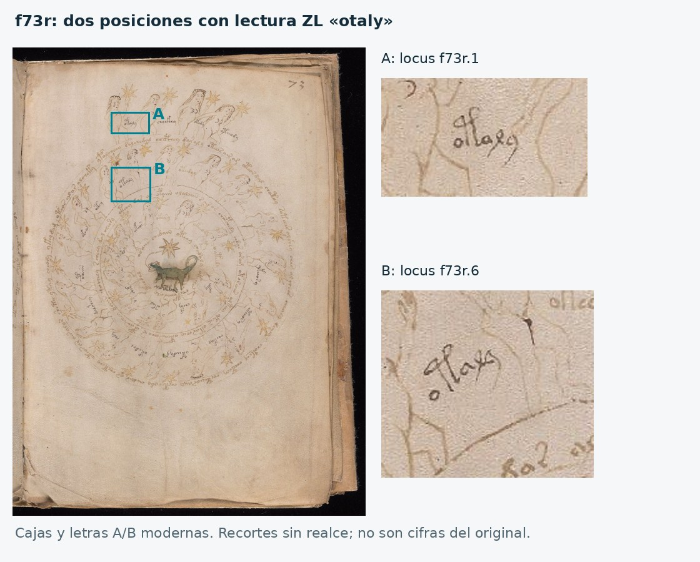

# 57 - Qué limitan las primeras pruebas numéricas

Fecha: 26 de octubre de 2026. Estado: **EXPLORATORY_NUMERAL_HYPOTHESIS_AUDIT**. No hay traducción ni una clave numérica validada.

Las reglas y el código se publicaron antes de ejecutar estos conteos, en el commit `58e814ba074dcc4e26fde0f4089150e5fcf40ad1`: [protocolo](56_numeral_hypothesis_protocol.md) y [plan ejecutable](data/numeral_probe_plan.json). El análisis no es ciego: se conocían los ejemplos de f49v, un duplicado de f73r y el corpus de experimentos anteriores. Se trata de contrastes exploratorios de modelos concretos, sin p-valores.

En particular, los conteos de los 26 renglones de f49v ya estaban almacenados en la tabla del inventario 55. Separar los cinco renglones de anclaje evita contarlos como evidencia a favor de su propia asociación, pero **no convierte los otros renglones en una reserva nueva o no examinada**. La evaluación es una comprobación de consistencia en material ya explorado.

## Resultado principal

**Las etiquetas zodiacales completas no son compatibles, en esta transcripción, con una lista canónica e invariable de los números 1-30 repetida en cada signo.** Hay repeticiones dentro del mismo signo y muy pocas coincidencias entre signos, aun dando un margen generoso a las lecturas excluidas.

Esto limita una lectura de las etiquetas. **La organización de los dibujos en 30 unidades permanece abierta**, incluida la hipótesis de grados zodiacales. Una etiqueta podría contener un número junto con un nombre o descripción; esa alternativa no se contrastó aquí.

La otra prueba limita algo distinto: las asociaciones 1-5 de f49v no predicen de forma útil la cantidad de palabras de los renglones que acompañan. No se deduce de ello que nunca sean cifras ni se refutan otros usos de una clave numérica.

## 1. Transferir la asociación de f49v

La clave condicional se conserva sin ajustarla: `o→1`, `r→2`, `y→3`, `e→4`, `@140;→5`. Los cinco renglones que suministraron las asociaciones quedan fuera de la nueva evaluación.

| Evaluación | Separar puntos | Separar puntos y comas | Solo fragmento izquierdo, puntos | Solo fragmento izquierdo, puntos y comas |
| --- | --- | --- | --- | --- |
| Renglones de anclaje, ya examinados | 1/5 | 1/5 | 1/5 | 1/5 |
| Otros renglones de f49v con signo cubierto | 0/11 | 0/11 | 1/11 | 1/11 |
| Pares locales cubiertos en f76r | 0/2 | 0/2 | 0/2 | 0/2 |

La sensibilidad previamente fijada que asimila `@192;` a `r` añade dos renglones de f49v: 0/13 al contar toda la línea y 1/13 al contar solo el fragmento izquierdo. No se añaden otras equivalencias.

Los dos casos externos son pequeños y explícitos: en f76r, el signo `o` precede al locus de texto 19, que tiene 11 palabras transcritas; `r` precede al locus 32, con 13 o 14 según la política de comas. Los valores hipotéticos 1 y 2 no coinciden. No se presenta una muestra de dos casos como evidencia universal.

Incluso permitiendo elegir para cada signo el número que mejor ajuste a todos los renglones de f49v, el máximo posible es 13/26, 16/26, 14/26 o 17/26, según las cuatro políticas anteriores. Son **límites de ajuste en los mismos datos**, no aciertos predictivos: varios signos reaparecen junto a cantidades diferentes. Una función simple signo→cantidad de palabras no explica toda la columna.

Se excluyó f66r del emparejamiento: 34 signos y 32 renglones, con alineación variable señalada por Stolfi. No se forzó una correspondencia por posición.

Datos: [renglones y predicciones](results/numeral_probes/direct_key_rows.csv), [resumen de aciertos](results/numeral_probes/direct_key_scores.csv) y [resultado completo](results/numeral_probes/result.json).

## 2. Comprobar una lista zodiacal 1-30 sin adivinar el punto inicial

El modelo contrastado supone una etiqueta completa canónica para cada número distinto de una serie 1-30, constante entre signos. Por tanto, una misma lista podría cambiar de orden, pero sus elementos seguirían siendo los mismos y no repetiría una etiqueta en dos posiciones diferentes del signo.

Se extraen las 299 etiquetas `Lz` de los doce diagramas. El filtro primario retiene **259** sin alternativas ni sintaxis editorial incierta; se omiten **40**, sin borrarlas del registro. Se mantienen los límites de palabras. Un análisis de sensibilidad elimina esos límites entre las mismas palabras y conserva los mismos casos elegibles.

### Repeticiones dentro de un signo

| Signo | Etiqueta ZL/EVA repetida | Loci |
| --- | --- | --- |
| Géminis | `okal` | f72r2.9, f72r2.11 |
| Géminis | `okaly` | f72r2.10, f72r2.18 |
| Leo | `okaly` | f72v3.9, f72v3.17 |
| Escorpio | `otaly` | f73r.1, f73r.6 |
| Sagitario | `oteody` | f73v.2, f73v.13 |
| Sagitario | `ykey` | f73v.28, f73v.31 |

Son seis formas repetidas, cada una dos veces, en cuatro signos. Las identificaciones son las de la transcripción filtrada; no equivalen a una certificación paleográfica de todos los trazos.

La sensibilidad que elimina los límites de palabras conserva los seis duplicados y los mismos cuatro signos. El máximo del límite generoso entre signos sigue siendo 14.

Se hizo una comparación visual de las dos ocurrencias de f73r. Se ven dos ubicaciones diferentes compatibles con la lectura transcrita `otaly`, con cambios de inclinación y disposición. El cotejo es de un asistente y no sustituye una segunda lectura experta.



Imagen original: Yale University Library, Beinecke MS 408. Las cajas A/B y la composición son modernas. Se conserva la huella de la captura, las coordenadas de los recortes y el alcance de la lectura en [visual_check.json](results/numeral_probes/visual_check.json).

### Pocas coincidencias incluso permitiendo cualquier reordenación

La intersección multiconjunto de dos listas es el máximo número de coincidencias exactas que se puede conseguir mediante **cualquier permutación**. Es un límite más permisivo que elegir un giro o un sentido de lectura de los círculos.

| Signos comparados | Etiquetas totales | Coincidencias inequívocas | Lecturas excluidas | Máximo generoso de coincidencias |
| --- | --- | --- | --- | --- |
| Aries y Libra | 30 y 30 | 0 | 0 y 3 | Como máximo 3/30 |
| Aries y Escorpio | 30 y 30 | 1 | 0 y 2 | Como máximo 3/30 |
| Aries y Sagitario | 30 y 30 | 0 | 0 y 3 | Como máximo 3/30 |
| Tauro y Cáncer | 30 y 30 | 0 | 7 y 7 | Como máximo 14/30 |

El límite generoso añade una posible coincidencia por cada lectura excluida, aunque no se haya demostrado. Puede sobreestimar las coincidencias reales; se usa deliberadamente a favor del modelo. Ninguno de los 45 pares de signos supera 14 coincidencias bajo ese margen.

Además, hay siete diagramas individuales de 30 etiquetas, que permiten 21 pares sin reunir mitades. En las listas exactas sin filtrar, el mayor solapamiento es 4/30. Este último conteo es descriptivo porque conserva la incertidumbre textual; el argumento más conservador es el límite con exclusiones informado arriba.

Datos: [cobertura por signo](results/numeral_probes/zodiac_sign_summary.csv), [límites bajo cualquier reordenación](results/numeral_probes/zodiac_order_free_overlap.csv), [pares de diagramas completos](results/numeral_probes/zodiac_complete_diagram_overlap.csv), [duplicados con sus loci](results/numeral_probes/duplicates.json) y [todas las etiquetas con criterios de admisión](results/numeral_probes/all_label_records.json).

## Qué se puede concluir

- La asociación de cifras 1-5 y signos de f49v **no se transfiere como contador directo de palabras** bajo las reglas examinadas.
- La lectura de **etiquetas zodiacales completas como una misma lista canónica 1-30** contradice estos datos transcritos. Cambiar el inicio de lectura o reordenar las etiquetas no corrige la diferencia entre sus conjuntos.
- No se excluyen números incrustados en frases, variantes contextuales, homofonía, prefijos dependientes del signo, otras unidades o usos del sistema numérico. Tampoco se demuestra que las etiquetas sean nombres propios.
- Las relaciones de 15+15 y 30 unidades en los dibujos siguen siendo pistas contextuales. **Estructura numérica del diagrama y significado numérico de su texto son preguntas diferentes.**

La ruta se vuelve más precisa: un método que proponga números dentro de las etiquetas tendrá que indicar qué componente expresa el valor, cómo explica los duplicados y qué predice en otro signo sin reajustar la regla. Antes de buscar equivalencias semánticas conviene comparar los componentes repetidos con sus posiciones y objetos asociados, conservando las excepciones y la incertidumbre de lectura.

## Reproducción, controles y procedencia

Corpus: ZL v3b, 13 mayo 2025; mismo archivo fijado en el inventario 55. SHA-256 `bf5b6d4ac1e3a51b1847a9c388318d609020441ccd56984c901c32b09beccafc`.

```bash
python research_gpt6/code/test_numeral_hypotheses.py \
  --corpus work/voynich_eva.txt \
  --plan research_gpt6/data/numeral_probe_plan.json \
  --output research_gpt6/results/numeral_probes

python research_gpt6/code/render_numeral_duplicate_evidence.py \
  --source work/scans/1006206.jpg \
  --metadata research_gpt6/results/numeral_probes/visual_check.json \
  --output research_gpt6/results/numeral_probes/f73r_duplicate_context.jpg

python research_gpt6/code/audit_numeral_probes.py \
  --data research_gpt6/results/numeral_probes \
  --plan research_gpt6/data/numeral_probe_plan.json \
  --source work/scans/1006206.jpg
```

El archivo de plan es el publicado antes de medir. La imagen procede de la captura pública ya registrada en `results/reordering/image_receipts_public.json`; se verifica su huella antes de generar la comparación. El filtro de elegibilidad conserva todos los registros omitidos para auditar el denominador.

[checks.json](results/numeral_probes/checks.json) registra 137 controles internos sin discrepancias: seis controles lógicos, recálculo de los aciertos desde sus filas, cobertura de loci, duplicados, límites aritméticos, huella del plan y regeneración exacta de la figura. Este resultado verifica el cálculo y sus archivos; no valida el significado del texto ni sustituye la lectura paleográfica.

Las limitaciones bibliográficas y de independencia del inventario anterior siguen vigentes: la transcripción y las descripciones de Zandbergen comparten historia de fuentes; el corpus ya se ha explorado; los recuentos no identifican por sí solos un idioma o una traducción. Los antecedentes de secuencias y dudas de alineación se encuentran en [Stolfi, Note 034](https://www.ic.unicamp.br/~stolfi/EXPORT/00-EXPORT/Notes/034/Note-034.html), y la estructura de los signos en [cuaderno 10](https://www.voynich.nu/q10/index.html), [cuaderno 11](https://www.voynich.nu/q11/index.html) y [cuaderno 12](https://www.voynich.nu/q12/index.html).
