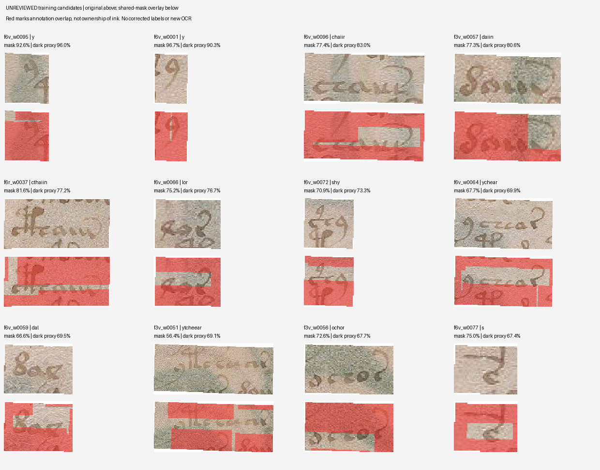

# 76 — El máximo CTC no recuperaría las 76 referencias no vistas

30 de octubre de 2026. Rama `experiment/kraken-voynich`.

**Se identificó una limitación concreta del modelo actual: incluso encontrar el máximo global de su probabilidad CTC fallaría las 76 formas no vistas de la hoja 7.** En cada caso existe una cadena distinta, ya obtenida por el haz, con más probabilidad que la referencia candidata, después de sumar todas las alineaciones de ambas cadenas. Este diagnóstico orienta la investigación; **no mejora el CER ni añade una traducción**.

La calidad del lector permanece en 434 errores / 709 caracteres EVA en la hoja 7, CER 61,2130 %, y 308/446 en las formas no vistas, 69,0583 %, con 0/76 exactas. Son las mismas salidas del ensayo 74, no otra inferencia favorable.

## Ejecución fijada y alcance

El [protocolo 75](75_alignment_and_search_diagnostic_protocol.md) y el [plan](data/kraken_alignment_diagnostic_plan.json) se publicaron en `33f1b5e6c7eb1c2dbde1be6c1775d2760e8ae3e6`, antes del cálculo completo. Se declararon la inspección previa de capacidad temporal y el carácter exploratorio de estos datos, ya consultados en otros ensayos.

Se verificaron los hashes del dataset, codec, modelo, archivo de resultados anterior y matrices originales de la primera pasada del run 40575635206. El modelo sigue siendo `expanded_200`, SHA-256 `35092d9baf56083eb6c70a2e32c478d8910ef5e685d0cee33fc5a935ca1c71d8`.

Se calcularon **3.202 probabilidades CTC de cadenas completas**, se examinaron **282 matrices** conservadas y **724 recortes y máscaras**. Entrenamientos nuevos: cero. Llamadas nuevas a la red: cero. No se eligió otra pasada, se incorporó un diccionario al lector ni se cambiaron etiquetas.

## Qué descarta el cálculo exacto

La búsqueda por haz suma sólo alineaciones retenidas. Aquí una programación dinámica en logaritmos suma todas las alineaciones posibles para cada cadena fijada. Si `P(referencia | imagen) < P(otra cadena | imagen)`, la referencia no es el máximo global. No hace falta enumerar todas las cadenas para demostrar esa desigualdad.

| Muestra | Salidas incorrectas del haz | Referencia con más masa que la salida | Referencia con menos masa |
|---|---:|---:|---:|
| Hoja 4: todas las 147 palabras | 138 | 0 | 138 |
| Hoja 7: todas las 135 palabras | 126 | 0 | 126 |
| Subgrupo no visto de la hoja 7 | 76 | 0 | 76 |

El último renglón pertenece al anterior; no es otra muestra independiente. Las 282 referencias tienen capacidad temporal suficiente y probabilidad positiva. La limitación observada no consiste en que la red haya producido menos instantes de los matemáticamente necesarios para escribirlas.

**Esto acota la explicación de los errores, sin localizar una causa única.** La señal visual del modelo y las etiquetas candidatas están en desacuerdo. Pueden intervenir asociaciones, encuadres, diversidad, representación o aprendizaje; el cálculo no certifica que la referencia sea la lectura paleográfica correcta. Tampoco prueba que otros decodificadores, otra función de coste o un modelo lingüístico no puedan cambiar el CER. El resultado concreto se refiere al máximo de la misma distribución CTC congelada.

Como diagnóstico adicional se puntuaron textos de la misma página y longitud. Entre las 76 formas no vistas, 75 tenían al menos una alternativa de esa longitud; su referencia encabezó en solitario 24 de esos 75 catálogos. Los catálogos contienen deliberadamente la respuesta y dependen de la longitud verdadera. **24/75 no es una nueva exactitud de reconocimiento**, ni una validación de palabras o significados. Se preservan todos los rangos, candidatos, empates y puntuaciones.

## Solapamiento de las anotaciones

Se contó la unión de píxeles compartidos entre máscaras de palabras del mismo folio, con su dilatación original de cuatro píxeles. La medida describe anotaciones superpuestas. No identifica qué palabra posee realmente un trazo ni equivale a un porcentaje de etiquetas incorrectas.

| Conjunto | Palabras | Máscara compartida ≥25 % | Mediana de área compartida | Mediana de píxeles oscuros compartidos, umbral principal |
|---|---:|---:|---:|---:|
| Entrenamiento original, hoja 3 | 197 | 86 | 23,28 % | 10,78 % |
| Entrenamiento adicional, hojas 5v/6 | 245 | 196 | 40,28 % | 20,88 % |
| Desarrollo histórico, hoja 4 | 147 | 38 | 16,53 % | 4,56 % |
| Evaluación ya explorada, hoja 7 | 135 | 98 | 34,18 % | 14,01 % |

La aproximación de oscuridad usa gris ≤ mediana local menos 40; se conservan también los resultados con 20 y 60. En la hoja 7 las medianas correspondientes son 19,70 %, 14,01 % y 12,56 %. Ninguno de esos umbrales constituye una segmentación validada de tinta.

El solapamiento no explica por sí solo todo el error. En la hoja 4, los grupos bajo, medio y alto tienen CER 42,31 %, 54,27 % y 63,13 %. En la hoja 7, el grupo medio tiene 61,75 % y el alto 60,78 %; el grupo bajo contiene una sola palabra y su 80 % no sirve como estimación estable. La relación no es uniforme entre hojas y puede confundirse con longitud, forma y posición. No se infiere causalidad de estas comparaciones.

La [documentación del proyecto de origen](https://github.com/voynichese/voynichese/blob/wiki/DataSets.md), recuperada en esta continuación, describe asociaciones espaciales semiautomáticas y reconoce incertidumbre en los límites de palabra. Su estimación histórica de errores no se adopta como una tasa medida para nuestras muestras. XML y JSON coincidentes siguen siendo dos serializaciones de la misma tradición, no dos revisiones independientes.

## Mejora del trabajo de revisión

Se creó una [cola de 442 muestras de entrenamiento](results/kraken_alignment_diagnostic/review_queue.json.gz), ordenada después del diagnóstico por fracción de píxeles oscuros compartidos, área compartida e identificador. No usa predicciones de OCR para priorizar ni incluye muestras de evaluación. Conserva imágenes, hashes, coordenadas, etiqueta candidata y campos de aprobación vacíos.



El rojo señala regiones compartidas de las máscaras, no tinta ajena certificada. Se revisó visualmente esta lámina y tres recortes originales como inspección del asistente; no es revisión experta independiente. Algunos ejemplos contienen trazos vecinos o pintura cerca de la escritura. **Muestras aprobadas: 0; etiquetas corregidas: 0; polígonos corregidos: 0.**

La prioridad siguiente es contrastar las asociaciones y límites de una muestra de entrenamiento con una lectura independiente, preservando también los ejemplos que resulten correctos. No se elimina automáticamente todo recorte solapado: eso podría quitar trazos legítimos y sesgar los datos. Repetir épocas o ampliar el haz no resuelve la discrepancia de probabilidades demostrada para estas referencias.

## Verificación y reproducción

Pasaron **ocho controles**: enumeración exhaustiva de caminos pequeños, cadena vacía y repeticiones, ceros y probabilidades diminutas, entradas inválidas, recurrencia independiente con reescalado, uniones de máscaras desplazadas, límites y máscaras dispersas, y exclusión de evaluación de la cola de revisión.

La [auditoría independiente](results/kraken_alignment_diagnostic/audit.json) pasó **27.433 comprobaciones sin discrepancias**. Calcula las mismas 3.202 masas en espacio de probabilidades con reescalado y poda de estados que no pueden terminar a tiempo. Verifica las máscaras mediante un lienzo completo que suma coberturas, separado de las intersecciones locales por parejas. Revisa hashes, rangos, aproximaciones de oscuridad, agregados y los 442 registros de revisión. No vuelve a inferir ni valida paleográficamente el texto.

La ejecución local leyó los PNG originales conservados con Pillow 13.0.0, NumPy 2.3.5 y Python 3.12.14. Para reconstruir los bytes originales de los PNG se fija Pillow 12.3.0. Los JSON grandes se preservan comprimidos sin pérdida, con inventario de hashes; los lectores aceptan ambas formas.

El [workflow](../.github/workflows/kraken-alignment-diagnostic.yml) implementa la reconstrucción desde un checkout limpio y compara todos los registros, rangos y resúmenes con lo preservado. **Estado de esa reproducción CI: PENDING al publicar esta primera entrega.** Se actualizará con evidencia de ejecución; no se cuenta como completada de antemano.

```bash
python -m pip install -r research_gpt6/data/kraken_alignment_diagnostic_requirements.txt
python research_gpt6/code/test_kraken_alignment_diagnostic.py
python research_gpt6/code/kraken_alignment_diagnostic.py \
  --plan research_gpt6/data/kraken_alignment_diagnostic_plan.json \
  --repo research_gpt6 --out work/alignment_diagnostic \
  --protocol-commit 33f1b5e6c7eb1c2dbde1be6c1775d2760e8ae3e6
python research_gpt6/code/render_kraken_alignment_review.py \
  --repo research_gpt6 --bundle work/alignment_diagnostic --out work/alignment_diagnostic
python research_gpt6/code/audit_kraken_alignment_diagnostic.py \
  --bundle work/alignment_diagnostic --repo research_gpt6 \
  --plan research_gpt6/data/kraken_alignment_diagnostic_plan.json \
  --out work/alignment_diagnostic/audit.json
```

[Procedencia](results/kraken_alignment_diagnostic/provenance.json). Identificación de lengua, revisión independiente y traducción: **NOT_RUN**.
