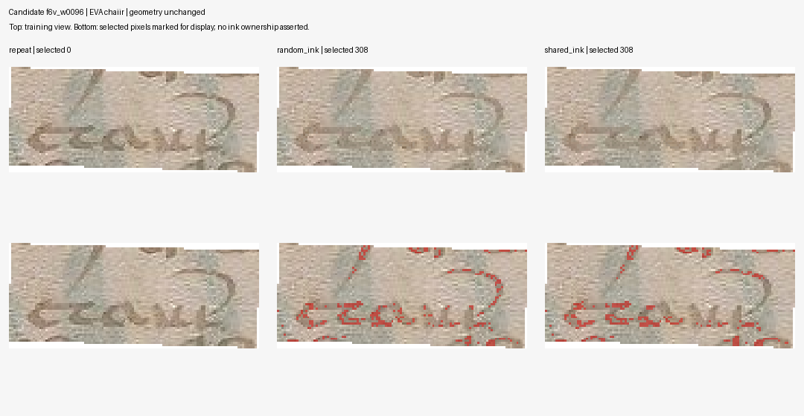

# 79 — Mejora de OCR en una hoja nueva; la hipótesis espacial no supera ambos controles

**3 de noviembre de 2026. Rama `experiment/kraken-voynich`.**

Se completaron tres reentrenamientos de Kraken, cada uno con 100 épocas y **5.600 pasos reales de optimizador**. En la reserva nueva f8r/f8v, el menor CER EVA observado corresponde al control de atenuación aleatoria: **727 errores / 1.280 caracteres, 56,80 %**, frente a **788/1.280, 61,56 %**, de la fuente congelada. La propuesta de atenuar regiones compartidas obtiene 735/1.280, **57,42 %**, y **no supera ambos controles**.

Es una mejora observada del paquete de reentrenamiento en esta hoja, no un desciframiento. La hipótesis espacial más específica no resultó ganadora. Un solo folio físico y una semilla no permiten declarar superioridad general ni significación tratando palabras como manuscritos independientes.

## Diseño fijado antes de evaluar

La [revisión crítica 77](77_estado_del_arte_2026_11_03.md) separa reconocimiento, estructura y significado. El [protocolo 78](78_shared_region_retraining_protocol.md) y el [plan](data/kraken_shared_region_plan.json) se publicaron en `723635a5d6d8743a825eba57943808cecb2862ec`, antes de ejecutar. Plan SHA-256: `92eef3c3bbbb3d0504d62ae8c7d0cd01c8de0dc43559bac94e780f083a646864`.

Los tres ajustes parten de `expanded_200`, SHA-256 `35092d9baf56083eb6c70a2e32c478d8910ef5e685d0cee33fc5a935ca1c71d8`, y conservan los 442 textos de entrenamiento y sus 2.087 caracteres EVA. Cada palabra aporta una vista original y una segunda: son **884 muestras derivadas, no 884 palabras independientes**. No se reinició la salida ni se añadieron caracteres del test al codec.

| Condición | Segunda vista | Píxeles seleccionados |
|---|---|---|
| `repeat` | Copia exacta de la original | Cero |
| `random_ink` | Atenuación hacia mediana RGB local | Píxeles oscuros aleatorios; exactamente la misma cantidad por palabra que en `shared_ink` |
| `shared_ink` | La misma atenuación | Píxeles oscuros en la intersección de máscaras de palabras del mismo folio |

Se mantiene la geometría y todos los píxeles no seleccionados. Oscuro significa gris ≤ mediana local menos 40; la atenuación es la semisuma entera fijada. La máscara compartida es una incertidumbre de anotación, no una atribución certificada de tinta a otra palabra. La vista intacta se conserva siempre.



La figura ilustra selecciones reales guardadas, elegida después por un criterio de datos de entrenamiento, sin mirar aciertos de OCR. El rojo es sólo una superposición de visualización. No representa una corrección paleográfica.

Todas las condiciones usan además la misma receta estándar de aumento de Kraken 7.1, con puerta 0,5 y hasta tres operaciones. Se preservó el código instalado y se verificó su identidad entre condiciones. CPU/dos hilos, semilla 20261103, lote 16, tasa constante 0,001, todas las capas ajustables y monitor exclusivamente de entrenamiento. Se evaluó siempre el último checkpoint, índice 99.

Por ello la mejora frente a la fuente mezcla continuar el ajuste y la augmentación común. No se atribuyen los 61 errores menos a una única operación. El contraste específico de la hipótesis espacial es frente a los otros dos modelos nuevos, que tienen igual número de vistas, pasos y configuración. Los entrenamientos se hicieron en servidores distintos; los tiempos no son un ensayo controlado de velocidad.

## Reserva nueva y su alcance real

Se fijaron f8r y f8v antes de consultar sus salidas de OCR. Las fotos Yale se verificaron contra hashes ya registrados; se comprobó igualdad de secuencia entre JSON y el XML licenciado de Voynichese. La geometría mantuvo los parámetros y umbrales de los ensayos anteriores.

| Página | Coincidencias recíprocas | Particiones geométricas aceptadas | Candidatos conservados |
|---|---:|---:|---:|
| f8r | 637 | 5/5 | 146 |
| f8v | 787 | 5/5 | 119 |
| Total, una hoja física | 1.424 | 10/10 | 265 |

Ambas páginas pasaron orientación y demás requisitos fijados. Dataset nuevo SHA-256: `8088c8d17d7e5142e817673dd992a413e9e63653933c5ebcc85033f790ca5195`. Se conservan fuentes, cajas, correspondencias, casos y rechazos; no se sustituyeron páginas ni relajaron umbrales.

Esta reserva es nueva para el ensayo OCR, no ciega para toda la historia del proyecto. Sigue conteniendo referencias candidatas de una misma tradición de transcripción, sin una nueva revisión experta. El registro geométrico, sus puntos reservados y sus hashes no certifican que cada caja contenga exactamente la cadena anotada.

## Resultado primario con el mismo proceso y denominador

Fuente y tres modelos se cargaron en un único proceso. Cada uno recibió exactamente los mismos 547 recortes originales: 282 históricos y 265 nuevos. Se hicieron dos pasadas, con **4.376 llamadas registradas a la red**. El máximo por instante reprodujo la salida original de Kraken en las 4.376 comprobaciones. Los textos y las matrices coincidieron entre pasadas; la primera estaba fijada como principal.

La tabla usa el haz 32 fijado, sin diccionario ni modelo de lenguaje. Se preservan también máximos por instante, que no se seleccionan a posteriori para favorecer una condición.

| Método | Errores EVA / 1.280 | CER | Exactas / 265 | Errores en cadenas no vistas / 778 | CER no vistas | Exactas no vistas / 140 |
|---|---:|---:|---:|---:|---:|---:|
| Fuente congelada, haz 32 | 788 | 61,56 % | 19 | 535 | 68,77 % | 0 |
| Originales repetidos, haz 32 | 738 | 57,66 % | 24 | **502** | **64,52 %** | 1 |
| Atenuación aleatoria, haz 32 | **727** | **56,80 %** | 29 | 509 | 65,42 % | **3** |
| Regiones compartidas, haz 32 | 735 | 57,42 % | 25 | **502** | **64,52 %** | 1 |
| Vecino por imagen | 796 | 62,19 % | **32** | 543 | 69,79 % | 0 |

El control aleatorio reduce 61 errores frente a la fuente: **4,7656 puntos porcentuales**. La propuesta espacial reduce 53, pero queda ocho errores por detrás del control aleatorio. Frente a originales repetidos sólo reduce tres errores; no basta para sostener una ventaja general.

Los criterios no ordenan los modelos igual: `random_ink` tiene el menor CER total, pero en las 140 cadenas no vistas suma siete errores más que los otros dos ajustes. El vecino por imagen conserva más coincidencias completas totales, aunque no puede acertar una referencia fuera de su vocabulario. No se declara un vencedor universal.

Las tres coincidencias no vistas del control aleatorio son:

| Identificador | Cadena EVA candidata | Longitud |
|---|---|---:|
| f8r_w0050 | `sol` | 3 |
| f8v_w0016 | `cty` | 3 |
| f8v_w0033 | `chary` | 5 |

No son aciertos de un único carácter. Son coincidencias con referencias candidatas, no palabras traducidas; por ejemplo, `sol` aquí no demuestra ningún significado en español o latín.

## Referencias históricas y generalización limitada

| Conjunto ya explorado | Fuente, haz 32 | Repetición | Aleatoria | Compartidas |
|---|---:|---:|---:|---:|
| Hoja 4, errores / 744 | 412 | 407 | **381** | 405 |
| Hoja 7, errores / 709 | 434 | 421 | **415** | 426 |
| No vistas de hoja 7: exactas / 76 | 0 | 0 | 0 | 0 |

El control aleatorio obtiene CER 51,21 % en la hoja 4 y 58,53 % en la 7. Esas son medidas secundarias de datos conocidos, no una segunda reserva confirmatoria. El fracaso en las 76 cadenas no vistas de la hoja 7 persiste. Tampoco se deben comparar el 61,21 % antiguo de la hoja 7 y el 56,80 % nuevo de la hoja 8 como si fueran un antes/después de las mismas muestras.

El ajuste de entrenamiento tampoco se confunde con generalización. Sobre las vistas originales, repetición, aleatoria y compartidas aciertan respectivamente 432, 434 y 440 de 442; sobre sus segundas vistas, 432, 434 y 431. Las referencias nuevas mantienen un error alto. Las diferencias de una sola semilla y hoja no separan todos los efectos de optimización y servidor.

## Incidencias y evidencia conservada

Los tres entrenamientos del [run 41643719527](https://github.com/MedinaParra/Voynich/actions/runs/41643719527), commit `9377583a54bfb8eed5871556b65e2f1d4fc47e0f`, terminaron con éxito. Ese run tiene un fallo de preparación distinto: faltaba SciPy en la reserva y se detuvo antes de adquirir sus datos. Se corrigió sólo la dependencia; no se repitieron ni cambiaron los modelos.

La [recuperación 41644234993](https://github.com/MedinaParra/Voynich/actions/runs/41644234993), commit `4130398d58d042ae2885226a2b09419a0f937b4d`, preparó la reserva. Su primer trabajo de evaluación falló por HTTP 500 de la API mientras esperaba artefactos, antes de cargar los modelos. Se reintentó sólo esa evaluación, conservando las mismas páginas, datos y pesos. La evaluación finalmente completada es la que se publica; se conservan los logs de fallos y éxito. No se cuentan esos fallos como nuevos ajustes o mediciones favorables.

Se descargaron y verificaron por SHA-256 los cinco ZIP: tres ajustes, reserva y evaluación común. Los modelos finales, checkpoints, inicializaciones, configuraciones, código de aumento, selecciones de píxeles y todos los posteriors quedan en Git; la conservación no depende sólo de artefactos temporales de Actions. Las máscaras de selección se reempaquetaron sin pérdida y los PNG derivados se reconstruyen y verifican por hash. Véase [NOTICE](results/kraken_shared_region/NOTICE.md).

| Modelo | SHA-256 |
|---|---|
| [Repetición](results/kraken_shared_region/runs/repeat/final_epoch.mlmodel) | `282856cb5c77a582532633b4020ec357b89c8568517e49790e7dcf7dbe1326ce` |
| [Aleatoria](results/kraken_shared_region/runs/random_ink/final_epoch.mlmodel) | `bb9cc0a9c7777bb373d85e20452e6443f6805ca83fed6e8af823dd149da0295a` |
| [Compartidas](results/kraken_shared_region/runs/shared_ink/final_epoch.mlmodel) | `a9835bb78849c9d4420de6c8ce74e2c0e4e8f46ce617e71df801f5b041f89095` |

## Auditoría y reproducción

La [auditoría separada](results/kraken_shared_region/audit.json) pasó **79.013 comprobaciones sin discrepancias**. Reconstruye las 2.652 vistas de entrenamiento y sus PNG, comprueba selecciones y controles de cantidad, y obtiene época 99 y paso 5.600 directamente de los contadores literales de los checkpoints sin ejecutar pickle. Usa coberturas de máscara por lienzo completo, cálculo escalar de atenuación, verificaciones de fuentes y geometría fresca, otra recurrencia del haz en espacio de probabilidades sobre las **4.376 matrices**, y distancias de edición por matriz completa. No vuelve a ejecutar la red ni realiza una lectura paleográfica.

También pasaron seis controles de la intervención, seis controles matemáticos CTC en la evaluación y tres del auditor. Son controles de software y aritmética de estos experimentos, no iteraciones de desciframiento. La auditoría verifica los registros tensoriales y los hashes de los modelos; no recarga independientemente sus tensores ni vuelve a ajustar SIFT.

Requisitos del auditor: NumPy, SciPy y Pillow 12.3.0, sin Torch ni Kraken. Desde un checkout limpio:

```bash
python -m pip install numpy==2.3.5 scipy==1.15.3 pillow==12.3.0
python research_gpt6/code/restore_shared_region_inputs.py --repo research_gpt6
python research_gpt6/code/test_shared_region_audit.py
python research_gpt6/code/audit_shared_region.py \
  --repo research_gpt6 --bundle research_gpt6/results/kraken_shared_region \
  --plan research_gpt6/data/kraken_shared_region_plan.json --out work/shared_audit.json
```

El [workflow de entrenamiento](../.github/workflows/kraken-shared-region.yml) fija el entorno neuronal y las condiciones. Las salidas de este informe son las obtenidas de verdad en los runs citados. El [workflow de auditoría](../.github/workflows/kraken-shared-audit.yml) también [pasó desde un checkout limpio de GitHub](https://github.com/MedinaParra/Voynich/actions/runs/41653792799), commit `acbe0cce0846ec751ec3f320d41279d19a6d6055`: restauró los 724 recortes anteriores y 265 nuevos y reprodujo las 79.013 comprobaciones, con igualdad de todos los campos del registro. Su ZIP se descargó y verificó contra el digest de GitHub; se conservan [el resultado](results/kraken_shared_region/fresh_checkout_audit.json), [el recibo](results/kraken_shared_region/fresh_checkout_receipt.json) y el log. Esta reproducción no añadió ajustes ni inferencias neuronales.

La conclusión operativa es conservar `random_ink` como candidato con el menor CER total observado en esta reserva y conservar los demás para comparación. La intervención espacial necesita otra justificación antes de atribuirle una ventaja. Las etapas de incertidumbre entre transcripciones y falsación lingüística de la revisión 77 siguen siendo diseño, **NOT_RUN**. El manuscrito no tiene una traducción validada en este trabajo.
