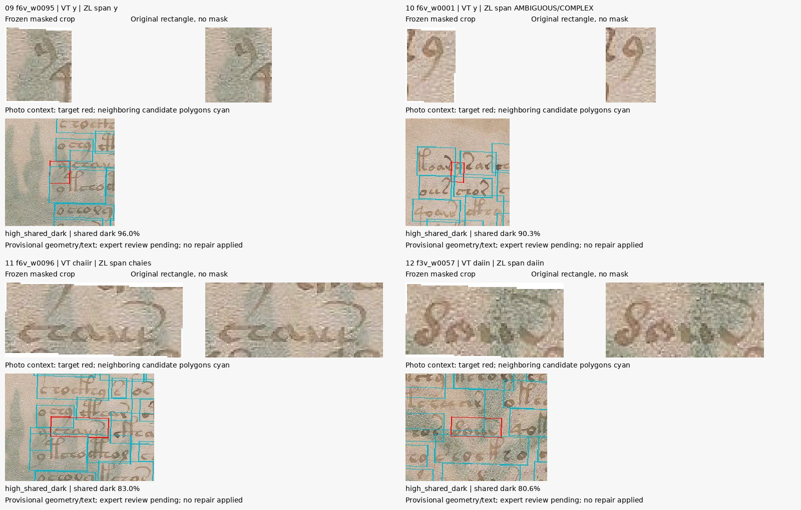

# 81 — Las lecturas discrepan en signos y límites; revisión de 24 candidatos

**3 de noviembre de 2026. Rama `experiment/kraken-voynich`.**

Se ejecutó el paso prioritario de la etapa anterior: contrastar lecturas diferenciadas, conservar su incertidumbre y revisar recortes con su contexto. No se entrenó ni se volvió a ejecutar Kraken. No se modificaron etiquetas, imágenes o particiones. La revisión paleográfica independiente sigue pendiente.

El [protocolo 80](80_transcription_boundaries_protocol.md) y el [plan](data/transcription_boundaries_plan.json) se publicaron en `53c4395fb26c295586a9ce1b9d98e72487c8d0a4` antes de calcular los desacuerdos. Las once páginas ya se habían usado en desarrollo/evaluación; esta comparación es descriptiva, sin una reserva nueva ni pruebas de significación.

## Qué fuentes se contrastaron realmente

La documentación del responsable de voynich.nu identifica VT/Voynichese e IT como versiones de la lectura de Takahashi. Compararlas no aportaría un segundo lector. Se empleó **`VT0e` frente a `ZL3b`**, una lectura diferenciada de Zandbergen/Landini en EVA. Comparten imágenes, alfabeto e historia editorial: no se presume independencia estadística de sus errores. RF, una combinación automática de otras lecturas, tampoco se contó como voto adicional.

Los originales VT y ZL se conservaron completos con sus encabezados. La descarga directa respondió 406; se obtuvieron de espejos versionados y se verificó identidad de blob Git en un segundo espejo. Eso verifica consistencia entre espejos, no un hash descargado del autor. Los [recibos](results/transcription_boundaries/sources/mirror_receipt.json) detallan versiones y hashes. El sitio de origen declara CC0 para las transliteraciones, con condiciones diferentes para sus fuentes tipográficas, que no se importaron.

Boxer declara una lectura propia desde imágenes y usa otro alfabeto. Se preservan sus originales congelados y el [contexto nativo de 61 filas](results/transcription_boundaries/boxer_context.json) de f3r/f3v/f4r/f4v. Sus conteos de palabras son 115/82/62/81 frente a 115/83/64/83 de Voynichese. No se inventó una conversión Boxer→EVA ni se calculó un supuesto acuerdo entre caracteres incompatibles. La independencia aquí es procedencia declarada por el autor; no una revisión experta nueva de nuestros recortes.

## Separar letras, espacios y variantes

El lector conserva cada cadena original y sus nodos: `.` separador, `,` separador dudoso, `<->` y `<~>` interrupciones por dibujo que implican separación, ligaduras, alternativas, códigos raros e ilegibles. No se borran los separadores de dibujo como si fueran comentarios. No se elige automáticamente la primera opción de `[a:b]`.

El cálculo literal usa una proyección explícita: letras minúsculas sin llaves de ligadura. Esa proyección no es una secuencia certificada de glifos y puede ocultar diferencias de unión, que permanecen en el original. Se excluyen del cálculo los loci con alternativas, ilegibles o códigos no representados; se guardan íntegros con el motivo. Los identificadores externos de locus, no el OCR ni el índice de palabra, fijan el emparejamiento.

| Resultado sobre las 11 páginas | Cantidad |
|---|---:|
| Loci emparejados |159|
| Comparables en la proyección literal |138|
| Excluidos por marcas complejas/ilegibles |21|
| Letras proyectadas iguales |98/138|
| De esos 98, posiciones de separación diferentes |24|
| Letras proyectadas diferentes |40/138|

Los 24 casos no incluyen todos los cambios de certeza entre punto y coma. Desde las fronteras de VT se registran 601 marcas iguales,86 de clase distinta,8 sin frontera correspondiente y 3 con posición de alineación ambigua. Son conteos de la comparación literal, no una medida de exactitud paleográfica.

Se calcula distancia de edición por locus y se conservan **todos los estados de coste mínimo**, mediante distancias de prefijo y sufijo. Un empate no se resuelve eligiendo arbitrariamente una ruta, y la cantidad de rutas no se interpreta como probabilidad de lectura.

Ejemplo concreto, **f3r.6**:

| Fuente | Fragmento |
|---|---|
| VT | `cthom.otal.dam` |
| ZL | `cthom.otaldam` |

Las letras de ese fragmento coinciden; la división no. Los candidatos `f3r_w0029` y `f3r_w0030` heredaron dos cajas de la opción VT. Esto identifica una decisión de anotación que necesita revisión, no demuestra cuál es la palabra lingüística correcta.

## Asociación con imágenes sin una unión forzada

Las secuencias completas de tokens del XML espacial coinciden exactamente con VT en las 11 páginas. Se comprobaron 990 tokens de fuente; los 989 recortes aceptados conservan la exclusión anterior de una caja no positiva. No se desplazaron índices para compensar discrepancias ni se modificaron referencias.

Ese puente exacto vincula dos formas de una misma fuente; **no aporta un segundo testigo ni localiza físicamente ZL de manera independiente**. Sus intervalos ZL se obtienen mediante la alineación textual provisional. Los extremos ambiguos se mantienen como conjuntos, sin producir automáticamente una etiqueta alternativa de entrenamiento.

Entre los 989 candidatos se registran 42 banderas de desacuerdo literal,43 de límite,76 de frontera incierta y 6 asociaciones con extremos ambiguos. Se solapan: son 139 candidatos literales con alguna bandera. Otros 154 pertenecen a loci complejos excluidos; en total 293 tienen alguna señal de revisión. No son 293 errores demostrados. La bandera de extremos no cuenta toda ambigüedad interna del alineamiento.

## Revisión visual ejecutada y qué queda pendiente

Se reconstruyeron máscaras y PNG de los 989 recortes y se comprobaron sus hashes congelados. El diagnóstico oscuro mantiene mediana gris de máscara menos 40; una posición compartida no certifica propiedad de tinta.

Se seleccionaron 24 palabras de entrenamiento con la regla fijada: ocho por desacuerdo/ambigüedad, ocho con mayor fracción oscura compartida y ocho con menor fracción, sin repeticiones ni selección por errores de OCR. Son 17 del entrenamiento original y 7 del adicional. La selección por ID concentra los primeros desacuerdos y controles bajos en f3r; no es una muestra representativa del manuscrito.

El asistente inspeccionó los 24 paneles en seis hojas de contacto y anotó observaciones por candidato. Las ampliaciones son sólo visualización por vecino más próximo. Cada panel permite comparar recorte congelado, rectángulo sin máscara y contexto original con polígonos vecinos.

- `f6v_w0095` y `f6v_w0001`: cajas estrechas dentro de franjas cubiertas por otras máscaras extensas; fracciones oscuras compartidas 96,0% y 90,3%. No se adjudica su tinta a otro token.
- `f6v_w0096`: se conservan VT `chaiir` y el intervalo ZL `chaies`, junto a la coma incierta anterior. El contexto no justifica cambiar la etiqueta automáticamente.
- `f3v_w0057`: ambas lecturas literales dan `daiin`, pero el rectángulo alcanza trazos del entorno. Acuerdo textual y pureza del recorte son preguntas diferentes.
- `f3r_w0047`: control de cero solapamiento oscuro bajo este umbral que aun presenta una discrepancia de frontera entre fuentes.



La [cola completa](results/transcription_boundaries/review_queue.json) distingue observación del asistente de `independent_expert_review=NOT_REVIEWED`. El [atlas HTML](results/transcription_boundaries/review.html), con sus imágenes en el mismo directorio, muestra además los loci crudos. Ninguna de estas observaciones aprueba un carácter, una caja o una palabra histórica. **Cambios de etiquetas: 0; cambios de geometría: 0.**

## Verificación y reproducción

El [auditor separado](code/audit_transcription_boundaries.py) pasó 147.044 comprobaciones sin discrepancias. Recalcula estados óptimos con Dijkstra sobre un grafo de edición, comprueba los puentes de tokens y la identidad de las fuentes. Incluye enumeración exhaustiva de rutas para 225 pares binarios de longitud 0–3 y casos de empate. Son controles de software, no iteraciones de desciframiento. No vuelve a interpretar paleográficamente las imágenes ni constituye un segundo parser completo de IVTFF/XML.

También pasaron cuatro controles del parser sobre separadores de dibujo, variantes conservadas, proyección y empates. Los resultados y sus límites se conservan en [el resumen](results/transcription_boundaries/summary.json), [el registro de auditoría](results/transcription_boundaries/audit.json) y los archivos completos comprimidos sin pérdida.

```bash
python -m pip install numpy==2.3.5 scipy==1.15.3 pillow==12.3.0
python research_gpt6/code/test_transcription_boundaries.py
python research_gpt6/code/audit_transcription_boundaries.py \
  --repo research_gpt6 --out work/transcription_audit.json
```

La [reproducción desde un checkout limpio en GitHub](https://github.com/MedinaParra/Voynich/actions/runs/41658081071), commit `f1b71b3725a362c8192c86dc7ccc54a33a183b5e`, terminó con éxito. Reconstruyó la comparación y los 989 recortes desde las fuentes preservadas, con igualdad completa de los registros derivados y la selección de revisión, sin Kraken, Torch o nuevos ajustes SIFT. El auditor reprodujo las 147.044 comprobaciones. Se descargó y verificó el digest del ZIP de resultados y se conservan [el recibo](results/transcription_boundaries/ci_receipt.json), el resumen, la auditoría y el log. Las observaciones visuales manuales no se presentan como reproducidas por CI.

## Decisión siguiente

La fase de cotejo y revisión provisional de la etapa B quedó implementada y ejecutada. La representación probabilística calibrada entre lectores y la revisión experta independiente siguen pendientes; la etapa C de mecanismos/identificabilidad no se ejecutó. El paquete ya permite revisar desacuerdos concretos sin imponer una etiqueta única por autoridad del OCR.

La evidencia aconseja revisar asociaciones y límites antes de otro ajuste. No basta con asumir que dos fuentes que coinciden garantizan una caja limpia, ni que toda diferencia sea un fallo del modelo. Este trabajo no reduce el CER por sí mismo y no produce una traducción.

Fuentes primarias: [procedencia de las transliteraciones](https://www.voynich.nu/data/000_README.txt), [historia de las ediciones](https://www.voynich.nu/transcr.html), [especificación IVTFF](https://www.voynich.nu/software/ivtt/IVTFF_format.pdf), [CC0 declarado](https://voynich.nu/roadmap.html#cop), [Boxer congelado](https://github.com/alexanderboxer/voynich-attack/tree/255bd632e45459230eaf2a994e0557ed6c682869). Detalle de atribución y límites en [NOTICE](results/transcription_boundaries/NOTICE.md).
