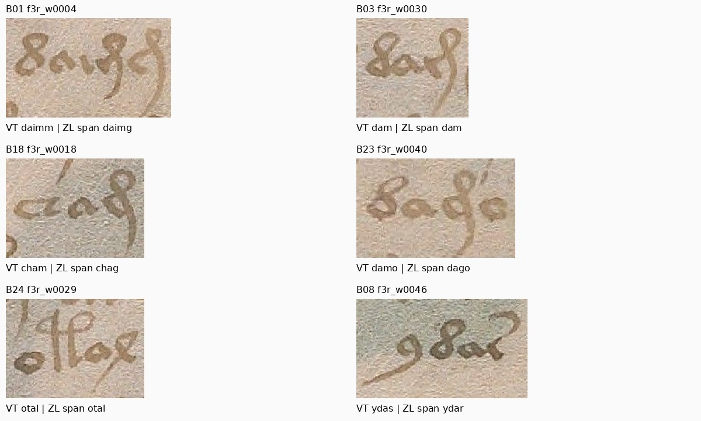

# 83 — Revisión paleográfica asistida: tres preferencias de lectura y once recortes prioritarios

**3 de noviembre de 2026. Rama `experiment/kraken-voynich`.**

Se revisaron los 24 candidatos de entrenamiento del informe 81 con fotografías Yale a su resolución nativa, descripción morfológica sin etiquetas de fuente y cotejo posterior con las lecturas VT/ZL. El resultado son **tres preferencias provisionales de transliteración**, once recortes que ambos lectores IA piden revisar y tres desacuerdos de revisión geométrica. Ninguna etiqueta o geometría se aprobó o cambió.

Esto es una revisión asistida por IA. No es el dictamen de un paleógrafo humano independiente. No hay una nueva medida de exactitud, entrenamiento de Kraken o traducción.

## Evidencia y procedimiento

El [protocolo 82](82_assisted_paleography_protocol.md) se publicó en `9c7ee0a4026959c613f897e9e3eb8f33af4a39b0`. Se conservaron los mismos 24 casos dirigidos del ensayo anterior; no son una muestra aleatoria del manuscrito ni una reserva nueva.

Se adquirieron las fotografías completas del mismo canvas Yale a las dimensiones declaradas por IIIF:

| Folio | Imagen anterior | Fotografía nativa utilizada |
|---|---:|---:|
| f3r |1800×2522|2691×3770|
| f3v |1800×2475|2762×3797|
| f6r |1428×2000|2662×3727|
| f6v |1450×2000|2753×3797|

Los [recibos](results/assisted_paleography/sources/acquisition_receipts.json) preservan URL, metadatos y hashes. Son nuevos píxeles de mayor resolución servidos por Yale, sin superresolución o restitución de trazos. Los rectángulos se trasladaron proporcionalmente desde el mismo canvas y se cotejaron con el contexto; no se presenta una nueva calibración SIFT o una exactitud geométrica subpíxel.

Dos revisores IA con contextos separados recibieron seis láminas con códigos opacos B01–B24 y orden fijo permutado. No se les suministraron nombres de folio, VT/ZL, resultados OCR ni las observaciones anteriores. Se les indicó consultar sólo ese paquete; la restricción fue de instrucciones, no un aislamiento de acceso auditado. La ceguera no elimina conocimiento previo o sesgos compartidos entre modelos. El asistente principal sí conocía las fuentes.

Los revisores describieron cuerpo, bucles, entradas, remates y separaciones visibles, sin asignar sonidos, lengua, significado o secuencia de ejecución de trazos. En una segunda pregunta dirigida se pidió describir cavidad cerrada o entrada abierta en cuatro casos, todavía sin opciones de transliteración. Esa selección y pregunta fueron realizadas por el principal con conocimiento de las fuentes: es exploratoria, no una prueba confirmatoria ciega del clasificador.

Se preservan las [dos revisiones iniciales y respuestas adicionales](results/assisted_paleography/reviews), la [correspondencia de códigos y coordenadas](results/assisted_paleography/presentation_mapping.json) y la [evaluación completa por caso](results/assisted_paleography/assessment.json). Las confidencias verbales son autoevaluaciones sin calibrar.

## Tres preferencias provisionales, con razones observables

| Candidato | VT actual | ZL | Preferencia asistida propuesta |
|---|---|---|---|
| `f3r_w0004` / B01 | `daimm` | `daimg` | `daimg` |
| `f3r_w0018` / B18 | `cham` | `chag` | `chag` |
| `f3r_w0040` / B23 | `damo` | `dago` | `dago` |

La diferencia propuesta es de representación gráfica bajo EVA, no una identificación de fonemas o de unidades lingüísticas. El resto de cada cadena procede de las fuentes; esta inspección no certifica carácter por carácter toda la palabra.

El modelo tipográfico EVA2 distingue `m` y `g` mediante la entrada/cuerpo izquierdo, aunque ambos pueden mostrar lazo superior y cola curva. En los tres signos discutidos se observa una panza lateral aparentemente cerrada. Esa forma favorece provisionalmente `g`, pero una tabla tipográfica no abarca todos los alógrafos reales ni establece una regla infalible.

En B01 hay un contraste dentro del mismo grupo: los dos revisores describen entrada oblicua abierta en la primera forma alta y cavidad cerrada en la última. En B18 y B23 ambos describen cavidad lateral cerrada, con reservas sobre contactos finos y textura del soporte. En B03, comparando otro remate, un revisor propone entrada abierta y el otro no lo resuelve, aunque se inclina hacia esa descripción. Se conserva esa diferencia, sin fabricar un control perfecto.



En esta figura, «ZL span» indica un intervalo de alineación, no necesariamente una palabra independiente en ZL. La [lista de propuestas](results/assisted_paleography/proposals.json) mantiene ambos textos y el estado **PROPOSED_NOT_APPLIED / NOT_APPROVED**. No se convirtió una coincidencia entre IA en referencia de entrenamiento.

La prioridad de estos tres casos se apoya en forma visible y comparación local, no en que la opción ZL sea más frecuente o encaje mejor con una lengua. Tampoco se extrapola a que ZL sea globalmente mejor. Las tres preferencias necesitan lectura experta, comparación de más ocurrencias y evaluación de variantes de forma.

## Lo que se mantiene abierto

- **`ydas` / `ydar`, B08:** se observa la curva terminal, pero no se adjudica `r/s` sólo por parecido con una letra latina o una plantilla tipográfica.
- **`sho.or` / `sho.vor`, B20/B22:** el cuerpo es visible; la marca pequeña próxima a la frontera y la ambigüedad de alineación no justifican asignar automáticamente un prefijo a una caja.
- **`y.chaiir` / `y,chaies`, B13/B16:** se conservan la incertidumbre de separación y de remates. El contexto muestra tinta de otras alturas de escritura.
- **`otal.dam` / `otaldam`, B24/B03:** hay separación gráfica apreciable entre grupos, pero su presencia no demuestra un límite léxico. Ninguna decisión de fusión o separación se aprueba.

Los minimales y los remates se describen como formas. No se convierten cadenas EVA `iin` en una `m` latina ni se presume una pronunciación.

## Revisión de los límites de los recortes

| Resultado de los dos lectores IA | Casos |
|---|---:|
| Ambos piden revisar el recorte |11|
| Ambos conservan el candidato como tal |10|
| Difieren en la acción geométrica |3|

Son acuerdos de observación, **no aciertos contra una verdad de referencia**. Los once prioritarios incluyen cajas con fragmentos de renglones vecinos por arriba o debajo y una caja estrecha de aislamiento incierto. No se ha determinado automáticamente a quién pertenece cada trazo ni cómo recortar sin perder remates legítimos.

Los tres desacuerdos son B08 (`f3r_w0046`), B10 (`f3r_w0045`) y B22 (`f3r_w0041`). Un lector considera relevantes pequeños fragmentos marginales; el otro conserva el cuerpo como aislable. Se registran ambos criterios en lugar de resolverlos por mayoría con el asistente principal.

Un contraste útil es B14 (`f3v_w0057`): el diagnóstico anterior señalaba 80,6% de posiciones oscuras compartidas, pero ambos lectores consideran aislable el cuerpo en la nueva presentación. Compartir máscaras no equivale a demostrar contaminación por tinta ajena; un acuerdo textual tampoco garantiza una etiqueta correcta. Este contraste impide tratar el solapamiento como una etiqueta automática de tinta ajena.

## Base documental y límites

La metodología de Davis compara formas repetidas y varios rasgos —lazos, pies, travesaños, inclinación y remates— antes de atribuir manos. Aquí se toma ese criterio descriptivo, sin replicar su estudio ni asignar escribas a 24 recortes. La ponencia es de 2022 y su volumen CEUR se publicó en 2023.

Se consultó la tabla de Landini **EVA Alphabet Font Version 2 Reference**, p.1. El portal de procedencia anuncia mayo de 2025, pero el PDF declara actualización de julio de 2004 y copyright 1997–2004; ambas fechas quedan registradas. Su tabla es un modelo tipográfico, no una fotografía paleográfica. Las marcas de archivo de ese documento histórico no se mezclan con IVTFF actual.

Las [referencias y alcance de acceso](results/assisted_paleography/source_references.json) permiten comprobar estas distinciones. No se infieren desde imágenes estáticas presión o levantamiento de pluma, orden de trazos, composición de tinta, cronología de manos o lengua.

## Integridad y reproducción

Se verificaron hashes de las fotos nativas, dimensiones IIIF, identidad de los 24 casos previos, coordenadas de presentación y consistencia de los registros. Las seis láminas se reprodujeron byte por byte localmente usando los mismos originales y una fuente de rótulos preservada con su licencia.

El [registro de integridad](results/assisted_paleography/integrity.json) explicita que esas comprobaciones **no validan la paleografía**. La reproducción informática ensambla observaciones ya registradas; no vuelve a leer las imágenes como un especialista. El resultado del workflow desde un checkout limpio se añadirá cuando exista.

```bash
python -m pip install pillow==12.3.0
python research_gpt6/code/verify_paleographic_review.py \
  --repo research_gpt6 --bundle research_gpt6/results/assisted_paleography \
  --out work/paleography_integrity.json
```

**Balance de cambios aplicados: etiquetas 0, geometrías 0, modelos 0.** Se completó una revisión asistida más específica y un paquete de tres propuestas y once prioridades de recorte. La aprobación paleográfica independiente sigue `NOT_REVIEWED`. No se ha obtenido una nueva mejora de OCR ni una traducción.

Fuentes primarias: [Davis, Voynich Paleography](https://ceur-ws.org/Vol-3313/keynote2.pdf), [índice CEUR y licencia](https://ceur-ws.org/Vol-3313/), [Landini, referencia EVA2](https://www.voynich.nu/hist/gabriel/eva2_reference.pdf), [procedencia del PDF](https://www.voynich.nu/hist/www_old.html), [minims y límites de unidades](https://www.voynich.nu/extra/sp_analysis.html). Fotografías: Yale University Library, Beinecke MS408. Véase [NOTICE](results/assisted_paleography/NOTICE.md).
