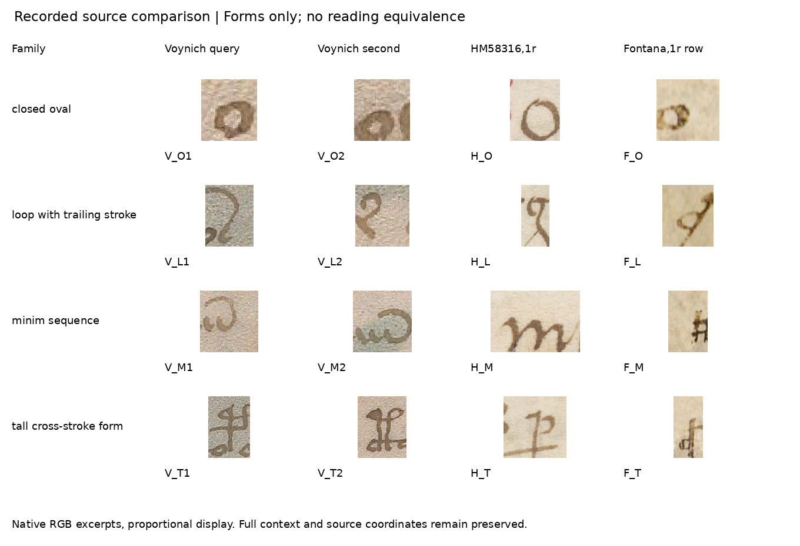

# Comparación de escrituras reales: resultado exploratorio

Fecha: 4 de noviembre de 2026. Rama: `experiment/kraken-voynich`.

La ruta se ejecutó con fotografías originales y dos lectores de IA en contextos separados. En esta muestra dirigida, HM 58316 aporta una semejanza fuerte compartida por ambos lectores: un óvalo, una forma elemental y muy extendida. Fontana no obtiene más calificaciones fuertes o parciales que los distractores. **No se ha establecido una correspondencia sistemática entre alfabetos ni una lectura del Voynich.** El control de lectura histórica de Fontana sigue bloqueado por una alineación no verificada.

## Diseño fijado y material utilizado

El [protocolo 92](92_script_comparanda_protocol.md) y el plan quedaron publicados en `dac160edb48c395b8b66016b37dcbcc394e4105e`. Los recortes, coordenadas, instrucciones y código de presentación se congelaron en `b01c94971722fd549a97eacbedf85bdde082648f`, antes de los juicios. [pre_review_freeze.json](results/script_comparanda/pre_review_freeze.json) permite comprobar sus hashes. Ninguno se cambió después de recibir las revisiones.

| Fuente | Página examinada | Uso y límite |
|---|---|---|
| Yale, Beinecke MS 408 | f. 3r | Cuatro consultas y cuatro comparandos de la misma fuente; no hay etiquetas paleográficas expertas |
| Huntington HM 58316 | f. 1r; catálogo: Venecia, 1440–1460 | Cuatro formas seleccionadas buscando semejanza; no representa todo el atlas |
| BSB Cod.icon. 242 | f. 1r, fila de alfabeto; catálogo del volumen: 1420–1430 | Cuatro formas; la fecha y mano de esa anotación concreta no se establecieron aquí |

El interés de HM 58316 tiene un antecedente explícito: Lisa Fagin Davis, *Voynich Paleography*, conferencia de 2022, volumen publicado en enero de 2023. Su comparación es sugerente, no determinante. Este piloto no descubre ese comparando ni demuestra una nueva relación histórica.

Se seleccionaron manualmente cuatro familias: óvalo cerrado, bucle con trazo terminal, secuencia de mínimos y forma alta con trazo transversal. Cada panel presenta una consulta Voynich y cuatro candidatos: otro ejemplo de la misma fuente, HM, Fontana y un ejemplo Voynich de otra familia. Los distractores reutilizan imágenes de las consultas; no son muestras independientes. Son 16 comparaciones por lector y 32 juicios en total.

Las imágenes conservan RGB y coordenadas nativas. La visualización iguala la altura conservando proporciones, con redondeo documentado y escalado NEAREST; no se limpió, reflejó ni reconstruyó la tinta. Los lectores no recibieron los nombres de las fuentes ni la correspondencia de candidatos. El papel y el estilo pueden revelar procedencia, y los archivos del proyecto no estaban aislados por permisos: se ocultaron etiquetas, sin garantizar un cegamiento completo. El preparador conocía las fuentes.

Los dos lectores son instancias de IA del mismo sistema, no especialistas humanos ni modelos de familias distintas. Sus juicios originales se conservan en [a.json](results/script_comparanda/reviews/a.json) y [b.json](results/script_comparanda/reviews/b.json), sin adjudicación posterior.

## Resultado observado

Ambos lectores produjeron los mismos conteos por grupo, aunque discreparon en dos comparaciones de la misma fuente:

| Grupo: cuatro candidatos por lector | Fuerte | Parcial | Diferente | Insuficiente |
|---|---:|---:|---:|---:|
| Otra muestra Voynich de la misma familia propuesta | 2 | 2 | 0 | 0 |
| HM 58316 | 1 | 2 | 1 | 0 |
| Fontana, fila de f. 1r | 0 | 2 | 2 | 0 |
| Distractor de otra familia | 0 | 2 | 2 | 0 |

El acuerdo de etiqueta es **14/16 comparaciones**. En P03/C, A dice parcial y B fuerte; en P04/E sucede lo contrario. Este acuerdo mide consistencia entre registros, no exactitud paleográfica. Los candidatos de la misma fuente son controles visuales provisionales, sin un patrón experto que certifique su identidad de signo.

Las unidades seleccionadas también son provisionales: en P03 los lectores describen el arco exterior y su remate de las muestras Voynich, mientras H_M es una sucesión de arcos. Comparar esos grupos completos no permite concluir que sus trazos mínimos individuales sean incompatibles. H_O parece una forma capital; igualar alturas elimina la información de tamaño relativo y línea base entre documentos. Su parecido fuerte no identifica una misma letra o ductus.

En HM, el óvalo H_O es fuerte para ambos; H_L y H_T son parciales, y H_M diferente. En Fontana, F_O y F_T son parciales, F_L y F_M diferentes. También dos distractores reciben parcial. Por eso una semejanza parcial aislada tiene escasa capacidad de discriminar en este ejercicio. Fontana y distractores tienen idéntica distribución marginal, pero eso no demuestra equivalencia de sus escrituras ni ausencia de cualquier relación histórica.



El [resumen completo](results/script_comparanda/summary.json) conserva los 16 pares, sus roles y las dos etiquetas. La muestra es pequeña, dirigida y procede de una página por fuente. No se calcularon pruebas de significación ni probabilidades de parentesco. Estos resultados no permiten descartar la propuesta completa de Davis, otras páginas de Fontana o cualquier sistema cifrado medieval.

## Fontana: referencia histórica recuperada y control todavía pendiente

Se inspeccionaron el original BSB Cod.icon. 242, f. 1v, y la transcripción de Heinrich Schulte de 1910, basada en el desciframiento de Wilhelm Meyer, BSB Cod.icon. 242a. El párrafo superior del original ya está en latín ordinario; el inferior está cifrado. La transcripción copia ambos. Leer su comienzo latino no habría validado un descifrador.

Se conserva una propuesta de alineación con la unidad latina `in`, con estado **CONTROL_BLOCKED_EXPERT_ALIGNMENT_REQUIRED**, coordenadas, recortes y dudas explícitas en [fontana_control_alignment_candidate.json](results/script_comparanda/fontana_control/fontana_control_alignment_candidate.json). Ni esa unidad ni la primera palabra del párrafo cifrado se aceptaron como verdad de referencia. Las líneas de las dos fuentes no envuelven igual y la segmentación de signos sigue sin certificarse.

La búsqueda documental sí recuperó una clave impresa explícita: Henri Omont, “Un traité de physique et d’alchimie du XVe siècle en écriture cryptographique”, *Bibliothèque de l’École des chartes* 58 (1897), 253–258, DOI [10.3406/bec.1897.447898](https://doi.org/10.3406/bec.1897.447898). Su página 254 contiene 23 pares signo/letra y explica cinco vocales: círculo = i; círculo con trazo izquierdo = a, derecho = u, superior = e e inferior = o. Describe también una barra de abreviación debajo de las palabras, capaz de representar m/n o una abreviación general.

**La tabla corresponde al BnF NAL 635**, otro manuscrito atribuido a Fontana. Se registra como **PRINTED_KEY_AVAILABLE_FOR_NAL635**. No se transfirió automáticamente a BSB Cod.icon. 242 ni al Voynich. Una posible expansión de círculo más barra como `in` compite con `im` y otros usos abreviativos; la observación ayuda a formular el control, sin resolver la alineación muniquesa. Es recuperación de una fuente histórica conocida, no un descubrimiento nuevo del campo.

El [registro de clave](results/script_comparanda/fontana_control/omont1897_key_reference.json) conserva procedencia, dimensiones, hash del escaneo completo y un recorte nativo con los pares impresos. El catálogo y texto de Persée identifican artículo y NAL 635; sus ilustraciones están enmascaradas. Se consultó el facsímil independiente del volumen de 1897 en Internet Archive para leer la tabla.

## Comprobaciones técnicas y alcance

El auditor, escrito por un agente distinto del preparador y sin importar su renderizador, obtuvo **PASS: 827 comprobaciones, cero discrepancias**, incluidos 32 juicios y sus agregaciones. Verifica geometría, hashes y píxeles; no certifica interpretaciones visuales, autenticidad histórica ni traducción. Los ocho contextos Voynich se contrastan con el JPEG original ya preservado. Para H/F se verificó el recorte contra las descargas originales al adquirirlos; la reproducción sin red usa los pequeños contextos conservados, no vuelve a descargar los originales completos.

HM presenta una discrepancia de metadatos conservada en el registro: `info.json` declara 9000×8968, mientras el JPEG entregado mide 9375×9342. Las coordenadas se refieren a este último. Los 47 hashes previos a los juicios permanecen fijados.

La [CI previa a las revisiones](https://github.com/MedinaParra/Voynich/actions/runs/41899233721) pasó con 670 comprobaciones y cero juicios disponibles. La reproducción posterior a los juicios está pendiente en esta versión del informe. Ejecutará el auditor y regenerará los recortes y paneles, comparando sus píxeles; no volverá a pedir juicios de IA. El ensamblador posterior crea la tabla y el atlas identificado; el auditor recalcula los conteos desde los archivos de lectura.

No se generaron nuevas etiquetas de entrenamiento ni se reentrenó Kraken con estas analogías. El siguiente paso que esta evidencia justifica es verificar con un paleógrafo una alineación signo/abreviación/texto de Fontana y probarla en una segunda línea reservada antes de tocar Voynich. Para investigar parentesco de escrituras haría falta una colección mayor con escrituras alternativas y muestreo establecido antes de buscar parecidos. **Traducción Voynich: no validada.**

## Reproducir

```bash
python -m pip install Pillow==13.0.0
python research_gpt6/code/audit_script_comparanda.py --repo research_gpt6 --bundle research_gpt6/results/script_comparanda --out work/integrity.json
python research_gpt6/code/prepare_script_comparanda.py --repo research_gpt6 --bundle research_gpt6/results/script_comparanda --out work/rendered
```

La CI compara los JSON de correspondencia, renderizado e integridad, y el RGB completo de los PNG de `glyphs/` y `blind/` regenerados. No regenera el atlas identificado ni los adjuntos documentales de Fontana/Omont, conservados con hashes. La congelación previa se comprueba por separado. Las fuentes fotográficas conservan sus avisos propios.
