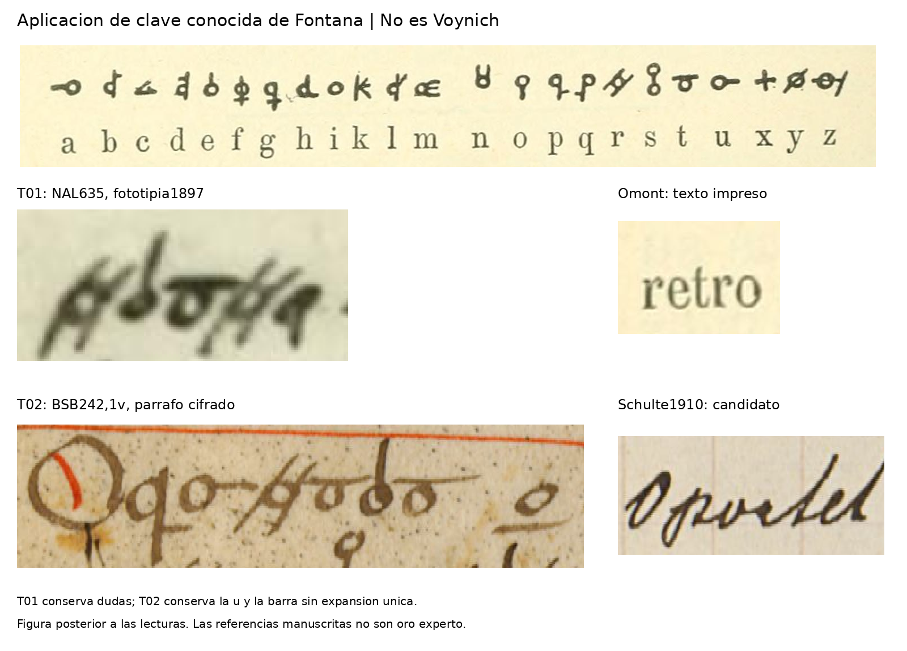

# Fontana: aplicación local de una clave histórica conocida

5 de noviembre de 2026. Rama `experiment/kraken-voynich`.

Se recuperó la fototipia publicada por Omont de cuatro páginas de NAL 635 y se aplicó su clave impresa a dos segmentos seleccionados, uno de NAL 635 y otro de BSB Cod.icon. 242. Dos lectores nuevos reconocen una secuencia local compatible con la referencia histórica, conservando dudas. **No se obtuvo una lectura única de todos los signos ni se validó una traducción del Voynich.** La clave era conocida y fue proporcionada: este ejercicio no equivale a descubrir un cifrado.

## Lo ejecutado

El [protocolo 94](94_fontana_key_application_protocol.md), objetivos, coordenadas, contextos y ampliaciones quedaron publicados en `b6d0852056ba091c7884dd917736d354662058b3` antes de solicitar las primeras lecturas. La congelación incluye diez archivos, contando la tabla de clave ya existente. Los preparadores habían consultado las transcripciones para elegir los segmentos. Por tanto, la selección fue dirigida y abierta frente a ellos; solamente se ocultaron las transcripciones a los dos lectores nuevos de IA, del mismo sistema y sin aislamiento garantizado por permisos.

La tabla procede de Henri Omont, “Un traité de physique et d’alchimie du XVe siècle en écriture cryptographique”, *Bibliothèque de l’École des chartes* 58 (1897), 253–258, [DOI 10.3406/bec.1897.447898](https://doi.org/10.3406/bec.1897.447898). Su clave se refiere a NAL 635. La [lámina recuperada](results/fontana_key_application/source_tiles/S02.jpg), en la hoja digital n261 del volumen, identifica expresamente la signatura. Es un escaneo de una fototipia de 1897, no una fotografía directa nueva del códice. Se conservan la página254 con tabla/transcripción y la lámina como fuentes distintas.

| Objetivo | Imagen cifrada | Referencia posterior |
|---|---|---|
| T01 | Primera palabra de la página superior izquierda de la lámina, NAL 635, f. 59v | `retro`, impreso en Omont p. 254, sección I |
| T02 | Primer grupo y círculo/barra siguiente del párrafo inferior cifrado, BSB 242, f. 1v | Primera palabra propuesta `Opurtet`, seguida de `in`, en Schulte de 1910; lectura manual candidata, sin certificación experta |

Los lectores sólo recibieron los dos objetivos y la tabla de 23 pares. No recibieron las propuestas de lectura, los recortes de Schulte o la transcripción de Omont. Se pidió aplicar formas literalmente, anotar alternativas y no completar por gramática. Las respuestas originales se conservan en [a.json](results/fontana_key_application/reviews/a.json) y [b.json](results/fontana_key_application/reviews/b.json), sin adjudicación ni nueva ronda.

## Lecturas originales y comparación

| Objetivo | LectorA, literal conservado | LectorB, literal conservado |
|---|---|---|
| T01 | `retr[o?]` | `retro` |
| T02 | `[O/Q?]purtet i [barra inferior]` | `Opurtet i[barra inferior]` |

**T01:** la propuesta coincide o es compatible con la palabra impresa `retro`, pero las dudas no desaparecen: A deja incierto el último signo; B ofrece `d` como alternativa secundaria para su segunda unidad, pese a escribir `e` en el literal. Ambos mencionan un fragmento incompleto en el borde derecho y no lo convierten en otra letra. No se informa una recuperación inequívoca por ambos lectores.

**T02:** ambos asignan `p-u-r-t-e-t` a los seis signos pequeños posteriores a la inicial. Son cinco valores distintos, con `t` repetida. La prolongación derecha del tercer signo motiva `u` bajo la clave; no se normaliza a `o` para fabricar el latín más familiar `oportet`. La referencia de Schulte parece conservar `Opurtet`; esta lectura manuscrita es una propuesta visual y no un patrón experto. A mantiene alternativas para la inicial decorada y para el círculo posterior. B registra una capital circular, que no considera del mismo aspecto que los signos pequeños de la tabla. No se valida la equivalencia completa de la inicial con un signo cifrado.

**Barra:** los dos lectores conservan el trazo inferior como marca separada y no lo expanden a una letra. La tabla gráfica por sí sola no indica su valor; el texto de Omont describe barras inferiores para terminaciones `m`/`n` u otras abreviaturas. La expansión propuesta `in` depende de la alineación histórica y de interpretar la marca como abreviación; `im` y otros usos no quedan excluidos sólo por el dibujo. También se conserva la alternativa de un trazo procedente de la línea inferior. Por ello el control de expansión única sigue pendiente.



El [registro de referencias](results/fontana_key_application/references/reference.json) ofrece fuentes, hashes y coordenadas. La figura comparativa se ensambló después de las lecturas; no fue un estímulo entregado a los lectores. Los recortes originales del resultado 93 y su candidato de alineación se mantienen sin modificar.

## Qué cambia respecto del estado anterior

Ahora hay una lámina localizada del manuscrito al que pertenece la tabla y una comprobación local explícita contra texto real. Además, el grupo BSB contiene varias correspondencias de orientación y trazo compatibles con esa clave, conservando una grafía poco familiar. Esto respalda estudiar una transferencia local de los signos observados; **no valida las23 asignaciones, todas las abreviaturas, otras páginas ni la identidad completa de ambos sistemas**. No se ha entrenado o evaluado un reconocedor automático.

La referencia bibliográfica, las claves y transcripciones ya existían. Es recuperación y aplicación documental dentro del proyecto, no un descubrimiento histórico nuevo ni una metodología inédita. Dos casos seleccionados y dos contextos de IA no permiten estimar precisión poblacional o hacer una prueba estadística. El acuerdo parcial tampoco equivale a revisión humana.

Para Voynich, la consecuencia metodológica es concreta: una búsqueda que fuerce un sonido por cada dibujo, o corrija salidas automáticamente hacia palabras conocidas, puede esconder abreviaturas y variantes. Esa advertencia procede de un comparando descifrado; **no demuestra que Voynich use esas mismas reglas**. No se asignó ningún valor de Fontana a signos Voynich ni se crearon etiquetas o pesos Kraken.

## Integridad y reproducción

El auditor independiente obtuvo **PASS, 125 comprobaciones, cero discrepancias**. La única primera pasada ya encontró las dos lecturas y verificó sus contenedores. El informe resultante se preserva sin repetirla localmente. Comprueba los diez hashes fijados, geometría, recortes nativos, ampliaciones NEAREST enteras y literales registrados. La fuente S01 se verifica contra el pequeño contexto archivado y su recibo de adquisición; su JPEG completo no está incluido para revalidarlo sin red. S02 sí conserva el escaneo completo. Esto no autentica fuentes históricas ni puntúa lecturas o referencias.

La [ejecución desde checkout limpio en GitHub](https://github.com/MedinaParra/Voynich/actions/runs/42046540242) pasó sobre el commit `8d54005e6d0121229ede2a9af867c1e5528c8234`: produjo el mismo JSON de integridad con las 125 comprobaciones y los cuatro literales. Se descargó el ZIP de 2.326 bytes y se verificó su SHA256 contra GitHub: `6fd44a67c588a3002d668a4fef15e7e1130df7f2354d8ea1f20c910039f4a59d`. El JSON contenido coincide con el archivado. [Recibo](results/fontana_key_application/ci_replay_receipt.json). La CI repitió únicamente la integridad técnica: no generó otra lectura, no comprobó las propuestas históricas y no regeneró la figura posterior.

```bash
python -m pip install Pillow==13.0.0
python research_gpt6/code/audit_fontana_key_application.py --repo research_gpt6 --bundle research_gpt6/results/fontana_key_application --out work/fontana_integrity.json
```

El paso que falta para convertir este material en una referencia de entrenamiento es revisar segmentación, iniciales y abreviaciones con un especialista y comprobar otra línea con esa referencia fijada. La conclusión actual es aplicación local compatible de una clave conocida, con ambigüedades conservadas. Voynich continúa sin traducción validada.
